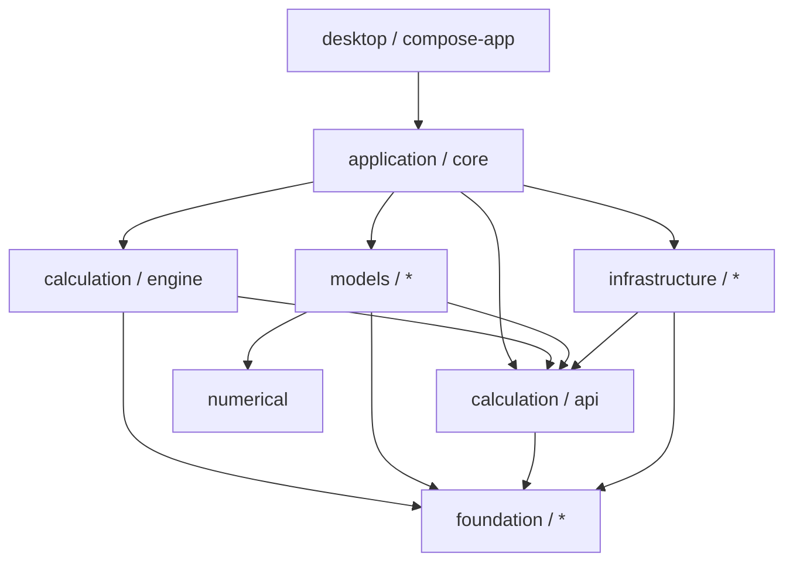

# Thermora Core — Architecture

**Версия документа:** 1.0  
**Статус:** Draft  
**Платформа:** Kotlin/JVM  
**Система сборки:** Gradle Kotlin DSL  
**Архитектурный стиль:** Modular Monolith, Clean Architecture, Hexagonal Architecture

---

## 1. Назначение системы

Thermora Core — независимое вычислительное ядро для инженерного анализа тепловых режимов радиоэлектронной аппаратуры.

Основная задача ядра — предоставлять единый механизм для подключения, проверки, выполнения и сравнения различных расчётных моделей.

Ядро должно обеспечивать:

- выполнение тепловых расчётов;
- поддержку нескольких реализаций одной физической задачи;
- валидацию входных параметров;
- контроль численной сходимости;
- диагностику ошибок и предупреждений;
- сравнение результатов различных моделей;
- пакетное выполнение расчётов;
- инженерную оптимизацию параметров;
- воспроизводимость ранее выполненных расчётов;
- расширение системы новыми физическими моделями.

Thermora Core не должен зависеть от конкретного пользовательского интерфейса, базы данных или формата хранения исходных данных.

### 1.1. Основная архитектурная идея

Вычислительное ядро строится вокруг независимых расчётных моделей.

Каждая модель реализует определённую инженерную задачу и предоставляет стандартизированный интерфейс взаимодействия с вычислительным движком.

Например:

- расчёт герметичного корпуса;
- расчёт внутреннего перемешивания;
- расчёт наружного обдува;
- расчёт корпуса с оребрением;
- расчёт перфорированного корпуса;
- расчёт корпуса с принудительным охлаждением.

Одна физическая задача может иметь несколько реализаций:

- **Legacy** — воспроизведение существующей расчётной методики;
- **Improved** — альтернативная реализация с физически обоснованными зависимостями.

Таким образом, вычислительный движок не должен знать внутреннее устройство конкретной модели. Он работает исключительно через общий API.

---

## 2. Архитектурные принципы

### 2.1. Независимость ядра

Thermora Core не зависит от:

- Compose Desktop;
- Android;
- JavaFX;
- PostgreSQL;
- SQLite;
- Apache POI;
- PDF-библиотек;
- HTTP-клиентов;
- файловой системы;
- конкретной операционной системы.

Взаимодействие с перечисленными технологиями осуществляется через внешние адаптеры.

### 2.2. Modular Monolith

На текущем этапе Thermora реализуется как модульный монолит.

Все модули находятся в одном Gradle-проекте и выполняются в рамках одного приложения, но имеют чётко определённые границы ответственности.

Это позволяет:

- сохранять простоту разработки и отладки;
- использовать общие типы без сетевого взаимодействия;
- контролировать зависимости между компонентами;
- независимо тестировать расчётные модели;
- впоследствии выделять отдельные компоненты при реальной необходимости.

Использование микросервисной архитектуры на данном этапе нецелесообразно: вычислительные модели не требуют независимого сетевого развертывания.

### 2.3. Clean Architecture

Архитектура разделяется на слои, а направление зависимостей направлено внутрь — к контрактам и предметной логике.

Внутренние компоненты не должны зависеть от деталей реализации внешних компонентов.

Например, расчёт герметичного корпуса не должен знать, откуда поступили исходные данные: из Excel, базы данных или пользовательской формы.

### 2.4. Hexagonal Architecture

Взаимодействие с внешним миром осуществляется через порты и адаптеры.

Порты определяют необходимые ядру операции, например сохранение истории расчётов.

Адаптеры реализуют эти операции с использованием конкретных технологий.

Пример:

- порт: `CalculationHistoryRepository`;
- адаптер: `PostgresCalculationHistoryRepository`.

При этом интерфейс порта не должен зависеть от PostgreSQL.

### 2.5. Plugin Architecture

Расчётные модели подключаются к системе через единый контракт.

В первой версии подключение осуществляется посредством Gradle-модулей и явной регистрации моделей.

Динамическая загрузка внешних JAR-плагинов не входит в начальный объём разработки.

Архитектура должна позволять добавить новую модель без изменения существующего вычислительного движка.

### 2.6. Разделение физики и численных методов

Необходимо различать:

- физическую модель;
- численный метод решения;
- механизм управления выполнением.

Физическая модель определяет зависимости между физическими величинами.

Численный модуль предоставляет алгоритмы решения математических задач.

Вычислительный движок управляет жизненным циклом расчёта.

Например, метод бисекции может использоваться несколькими тепловыми моделями, но сам по себе не должен содержать сведений о геометрии корпуса или коэффициенте теплоотдачи.

---

## 3. Общая архитектура

Система разделяется на семь логических областей:

1. Foundation
2. Calculation API
3. Calculation Engine
4. Numerical
5. Application
6. Infrastructure
7. Presentation

### 3.1. Foundation

Фундаментальные типы и предметные понятия системы.

Отвечает за:

- общие идентификаторы;
- физические величины;
- единицы измерения;
- базовые геометрические типы;
- материалы;
- общие теплофизические понятия.

Foundation не содержит расчётных алгоритмов.

### 3.2. Calculation API

Публичный контракт взаимодействия вычислительного движка и моделей.

Отвечает за:

- описание расчётной модели;
- типизированные входные и выходные данные;
- запросы на выполнение;
- контекст выполнения;
- результаты;
- статусы расчётов;
- диагностические сообщения;
- интерфейсы моделей.

API не содержит реализаций физических моделей.

### 3.3. Calculation Engine

Управляет выполнением расчётов.

Отвечает за:

- поиск зарегистрированной модели;
- проверку совместимости входных данных;
- запуск валидации;
- создание контекста выполнения;
- запуск расчётной модели;
- обработку результатов;
- преобразование ожидаемых ошибок в соответствующие статусы;
- формирование итогового результата.

Calculation Engine не содержит физических формул.

### 3.4. Numerical

Содержит универсальные численные методы.

Предполагаемые компоненты:

- Root Finding;
- Bisection Method;
- Newton Method;
- Fixed-Point Iteration;
- Interpolation;
- Numerical Integration;
- Convergence Criteria.

Численные алгоритмы не должны зависеть от конкретных моделей.

### 3.5. Application

Организует выполнение пользовательских сценариев.

Отвечает за:

- запуск отдельных расчётов;
- пакетное выполнение;
- сравнение моделей;
- инженерную оптимизацию;
- управление доступными моделями;
- координацию параллельных вычислений.

Application связывает вычислительный движок, зарегистрированные модели и внешние порты.

### 3.6. Infrastructure

Содержит реализации взаимодействия с внешними системами.

Предполагаемые компоненты:

- Persistence;
- Serialization;
- Excel Import;
- Export;
- File Storage.

Infrastructure не должна содержать физические формулы.

### 3.7. Presentation

Пользовательский интерфейс.

Первой реализацией является Compose Desktop.

Presentation отвечает за:

- ввод параметров;
- отображение результатов;
- визуализацию геометрии и тепловых процессов;
- отображение диагностических сообщений;
- управление пользовательскими сценариями.

Интерфейс обращается к Application, но не вызывает физические расчётные функции напрямую.

---

## 4. Структура Gradle-проекта

Предлагаемая структура:

```text
thermora/
│
├── settings.gradle.kts
├── build.gradle.kts
├── gradle.properties
│
├── foundation/
│   ├── common/
│   ├── units/
│   └── domain/
│
├── calculation/
│   ├── api/
│   ├── engine/
│   ├── validation/
│   └── registry/
│
├── numerical/
│   ├── linear-algebra/
│   ├── optimization/
│   ├── interpolation/
│   └── solvers/
│
├── models/
│   ├── sealed-housing-legacy/
│   ├── internal-mixing-legacy/
│   ├── external-cooling-legacy/
│   ├── finned-housing-legacy/
│   ├── perforated-housing-legacy/
│   ├── forced-cooling-legacy/
│   │
│   ├── sealed-housing-improved/
│   ├── internal-mixing-improved/
│   └── external-cooling-improved/
│
├── intelligence/
│   │
│   ├── api/
│   │
│   ├── hardware/
│   │   ├── detection/
│   │   ├── profiling/
│   │   └── capability-evaluation/
│   │
│   ├── runtime/
│   │   ├── model-manager/
│   │   ├── execution-manager/
│   │   └── resource-manager/
│   │
│   ├── inference/
│   │   ├── cpu/
│   │   └── gpu/
│   │
│   ├── models/
│   │   ├── thermal-prediction/
│   │   ├── geometry-recognition/
│   │   └── optimization/
│   │
│   └── document-analysis/
│
├── application/
│   └── core/
│
├── infrastructure/
│   ├── persistence/
│   ├── serialization/
│   ├── excel-import/
│   ├── export/
│   ├── model-storage/
│   └── remote-calculation/
│
├── desktop/
│   └── compose-app/
│
├── backend/
│   └── server/
│       └── src/main/java/
│           └── com/thermora/server/
│               ├── controller/
│               ├── service/
│               ├── dto/
│               ├── security/
│               ├── licensing/
│               └── config/
│
├── docs/
│
└── tests/
    ├── integration/
    ├── benchmarks/
    └── reference-calculations/
```

Это целевая логическая структура, а не требование создать все модули одновременно.

Модули добавляются по мере появления соответствующей функциональности.

### 4.1. foundation/common

Содержит базовые типы, используемые несколькими внутренними модулями:

- идентификаторы;
- общие технические типы;
- базовые исключения;
- простые общие абстракции.

Не должен становиться хранилищем произвольных утилит.

### 4.2. foundation/units

Отвечает за физические величины и единицы измерения.

Примеры:

- Length;
- Area;
- Volume;
- Temperature;
- TemperatureDifference;
- Pressure;
- Power;
- ThermalConductivity;
- HeatTransferCoefficient;
- ThermalResistance.

Внутреннее представление физических величин использует SI.

### 4.3. foundation/domain

Содержит общие предметные понятия:

- Material;
- Geometry;
- AmbientConditions;
- ThermalBoundaryCondition.

В этот модуль включаются только понятия, обладающие единым физическим смыслом для нескольких моделей.

Специфические параметры конкретной расчётной задачи остаются внутри соответствующего модельного модуля.

### 4.4. calculation/api

Содержит публичные интерфейсы:

- `CalculationModel`;
- `ModelDescriptor`;
- `ModelId`;
- `CalculationRequest`;
- `CalculationResult`;
- `CalculationContext`;
- `Diagnostic`;
- `ValidationReport`;
- `CalculationStatus`.

API является основным контрактом расширения системы.

### 4.5. calculation/engine

Реализует:

- `CalculationEngine`;
- `ModelRegistry`;
- механизм диспетчеризации;
- управление жизненным циклом расчёта;
- обработку ошибок выполнения.

Модуль зависит от Calculation API, но не зависит от конкретных физических моделей.

### 4.6. numerical

Содержит независимые численные алгоритмы.

Модель может использовать несколько численных методов, если это соответствует её математической постановке.

Модуль не должен зависеть от Application, Infrastructure или Presentation.

### 4.7. models

Каждая модель располагается в отдельном Gradle-модуле.

Например:

```text
sealed-housing-legacy/
│
├── src/
│   ├── main/
│   │   └── kotlin/
│   │       └── ...
│   │
│   └── test/
│       └── kotlin/
│           └── ...
│
└── build.gradle.kts
```

Внутри модели размещаются:

- типы входных данных;
- типы выходных данных;
- предметная валидация;
- физические зависимости;
- расчётные алгоритмы;
- адаптация численных методов;
- тесты.

Не требуется искусственно создавать отдельный Gradle-модуль для каждого внутреннего пакета модели.

### 4.8. application/core

Содержит прикладные сценарии:

- запуск расчёта;
- сравнение двух моделей;
- пакетное выполнение;
- оптимизация;
- координация вычислений;
- сборка и регистрация доступных моделей.

Именно Application определяет, какие реализации подключены в конкретной конфигурации приложения.

### 4.9. infrastructure

Реализует внешние механизмы хранения и обмена данными.

Например:

```text
persistence/
├── CalculationHistoryRepository
└── postgres/
    └── PostgresCalculationHistoryRepository
```

Контракты портов должны принадлежать внутреннему слою, который ими пользуется. Если интерфейсы хранения нужны Application, их следует разместить в Application или отдельном модуле Application Ports.

### 4.10. desktop/compose-app

Содержит Compose Desktop-приложение.

Модуль отвечает за пользовательский интерфейс и интеграцию с Application.

Внутри него не должны находиться:

- физические формулы;
- реализации расчётных моделей;
- численные методы;
- логика регистрации моделей.

---

## 5. Граф зависимостей

Основное правило: зависимости направлены от внешних компонентов к внутренним контрактам.



Допускается, что Infrastructure реализует интерфейсы, объявленные Application. Поэтому зависимость Infrastructure от Application Ports является допустимой, если она не создаёт обратной зависимости Application от Infrastructure.

### 5.1. Разрешённые зависимости

| Модуль | Может зависеть от |
|---|---|
| foundation/common | Стандартная библиотека |
| foundation/units | foundation/common |
| foundation/domain | foundation/common, foundation/units |
| calculation/api | foundation/common, foundation/units, foundation/domain |
| calculation/engine | calculation/api, foundation |
| numerical | foundation/units, foundation/common |
| models/* | calculation/api, foundation, numerical |
| application/core | calculation/api, calculation/engine, models/*, Application Ports |
| infrastructure/* | Внутренние контракты, необходимые адаптеру |
| desktop/compose-app | application/core, Compose |

### 5.2. Запрещённые зависимости

- Foundation не зависит от Calculation, Application, Infrastructure или Presentation.
- Calculation API не зависит от Engine и конкретных моделей.
- Calculation Engine не зависит от конкретных физических моделей.
- Numerical не зависит от моделей и Application.
- Модели не зависят от Compose, БД и Excel-библиотек.
- Application не зависит от конкретных реализаций Infrastructure.
- Presentation не содержит физическую расчётную логику.

---

## 6. Архитектура расчётных моделей

### 6.1. Единый контракт

Каждая модель реализует общий интерфейс:

```kotlin
interface CalculationModel<I : Any, O : Any> {

    val descriptor: ModelDescriptor

    fun validate(input: I): ValidationReport

    fun calculate(
        input: I,
        context: CalculationContext
    ): ModelExecution<O>
}
```

Типы `I` и `O` определяются конкретной моделью.

Например, герметичный корпус имеет собственные входные и выходные типы:

```kotlin
data class SealedHousingInput(
    // Параметры конкретной модели
)

data class SealedHousingOutput(
    // Результаты конкретной модели
)
```

Этот пример не фиксирует окончательный состав физических параметров. Он будет определён после аудита исходных расчётных листов.

### 6.2. Идентификаторы моделей

Каждая реализация получает стабильный уникальный идентификатор.

Примеры:

```text
thermora.sealed-housing.legacy
thermora.sealed-housing.improved

thermora.internal-mixing.legacy
thermora.external-cooling.legacy
```

Идентификатор не должен зависеть от имени Kotlin-класса или отображаемого названия модели.

### 6.3. Legacy

Legacy — программная реализация существующих расчётных методик.

Основные требования:

- воспроизведение исходной логики Excel;
- сохранение исторических особенностей расчёта;
- фиксация известных ошибок и неоднозначностей;
- покрытие контрольными тестами;
- сохранение возможности сравнения с исходными результатами.

Обнаруженные ошибки не должны незаметно исправляться в Legacy.

Если исправление изменяет вычислительное поведение, оно должно быть явно задокументировано и отражено в версии алгоритма.

### 6.4. Improved

Improved — отдельная реализация физической задачи.

Она должна использовать обоснованные физические зависимости и документированные предпосылки.

Для каждой Improved-модели необходимо фиксировать:

- источники используемых зависимостей;
- область применимости;
- допущения;
- граничные условия;
- ограничения;
- критерии достоверности результата.

Неизвестное происхождение эмпирической формулы не является основанием считать её физически корректной.

### 6.5. Сравнение моделей

Legacy и Improved не должны вызывать друг друга.

Их сравнение выполняется на уровне Application.

Application формирует общий сценарий, запускает обе реализации и сопоставляет физически совместимые результаты.

Сравнение возможно только при одинаковом физическом смысле величин, сопоставимых входных условиях и корректных единицах измерения.

---

## 7. Calculation Engine

Calculation Engine — центральный механизм выполнения расчётов.

Его ответственность ограничивается управлением вычислительным процессом.

### 7.1. Жизненный цикл расчёта

```text
Calculation Request
        |
        v
Resolve Model
        |
        v
Check Input Compatibility
        |
        v
Validate Input
        |
        +---- Invalid ----> INVALID_INPUT
        |
        v
Create Execution Context
        |
        v
Execute Calculation Model
        |
        v
Process Model Execution
        |
        v
Create Calculation Result
        |
        v
Return Result
```

### 7.2. Основные обязанности

1. Найти модель по идентификатору.
2. Проверить совместимость входных данных.
3. Выполнить валидацию.
4. Создать контекст выполнения.
5. Запустить модель.
6. Обработать ожидаемые вычислительные исходы.
7. Сформировать единый результат.
8. Передать результат вызывающему Application.

### 7.3. Что не входит в обязанности Engine

Engine не должен:

- самостоятельно выбирать физические формулы;
- рассчитывать теплопроводность;
- определять геометрию корпуса;
- выполнять инженерную оптимизацию;
- обращаться к БД;
- читать Excel;
- отображать результаты.

---

## 8. Numerical Engine

Численные методы выделяются в самостоятельную область, поскольку могут использоваться различными физическими моделями.

Предполагаемые алгоритмы:

| Алгоритм | Назначение |
|---|---|
| Bisection | Поиск корня на интервале |
| Newton-Raphson | Итерационный поиск корня |
| Fixed-Point Iteration | Решение уравнений методом простой итерации |
| Interpolation | Интерполяция табличных данных |
| Numerical Integration | Численное интегрирование |
| Convergence Monitor | Контроль сходимости |

Для каждого метода необходимо определить:

- критерии остановки;
- максимальное число итераций;
- численные допуски;
- условия применимости;
- обработку некорректных значений;
- диагностику отсутствия сходимости.

Численные допуски должны учитывать физический смысл и размерность вычисляемой величины.

Не следует использовать один универсальный абсолютный допуск для температуры, мощности и теплового сопротивления.

---

## 9. Параллельное выполнение и оптимизация

Параллельное выполнение организуется на уровне Application, а не внутри отдельных моделей.

Это позволяет централизованно контролировать:

- количество одновременно выполняемых расчётов;
- использование процессорных ресурсов;
- отмену задач;
- сбор результатов;
- обработку ошибок отдельных задач.

Для Kotlin/JVM предполагается использование Kotlin Coroutines.

Важно: `suspend` сам по себе не гарантирует параллельное выполнение. Политика диспетчеризации и ограничения параллелизма должны задаваться явно.

### 9.1. Batch Execution

Batch Execution позволяет запускать несколько расчётов в рамках одного сценария.

Примеры:

- сравнение разных геометрических параметров;
- расчёт нескольких вариантов охлаждения;
- сравнение Legacy и Improved;
- исследование влияния мощности тепловыделения.

### 9.2. Optimization

Оптимизация является прикладным сценарием.

Numerical предоставляет численные алгоритмы, а Application формирует инженерную задачу:

- целевую функцию;
- переменные проектирования;
- ограничения;
- допустимые диапазоны;
- критерии выбора результата.

Успешное выполнение численного алгоритма не означает, что полученный инженерный вариант физически допустим.

---

## 10. Версионирование и воспроизводимость

Каждый расчёт должен сохранять сведения, необходимые для его последующего воспроизведения.

Минимальный состав метаданных:

```text
Calculation ID
Model ID
Model Version
Algorithm Version
Input Schema Version
Output Schema Version
Calculation API Version
Thermora Core Version
Input Snapshot
Output Snapshot
Diagnostics
Numerical Options
Execution Timestamp
```

### 10.1. Версионирование модели

Версия модели отражает изменения её контракта и предметного поведения.

### 10.2. Версия алгоритма

Версия алгоритма отражает изменения расчётной логики, корреляций и численных процедур, которые могут влиять на результат.

### 10.3. Версия Core API

Версия API отражает совместимость контрактов между движком и моделями.

### 10.4. Воспроизводимость

Для повторного выполнения должны быть доступны исходный снимок входных данных и все версии компонентов, влияющих на результат.

Если расчёт зависит от внешней таблицы, базы материалов или другого изменяемого источника, необходимо сохранять версию либо снимок использованных данных.

---

## 11. Диагностика и физическая допустимость

Необходимо разделять три независимых аспекта:

1. Корректность входных данных.
2. Успешность вычислительного процесса.
3. Физическая допустимость результата.

Например, численный алгоритм может успешно найти решение, при котором температура корпуса превышает допустимый предел материала.

В таком случае вычисление завершилось успешно, но инженерный результат недопустим.

Поэтому статус расчёта не должен смешиваться с оценкой физической допустимости.

Диагностика должна содержать машинный код, уровень серьёзности, описание и при необходимости ссылку на конкретное поле входных данных или этап расчёта.

---

## 12. Тестирование

Тестирование должно охватывать как отдельные модули, так и взаимодействие всей системы.

### 12.1. Unit Tests

Проверяют:

- физические величины;
- преобразования единиц;
- геометрические ограничения;
- валидацию;
- численные алгоритмы;
- отдельные расчётные зависимости.

### 12.2. Golden Tests

Особенно важны для Legacy.

Для заранее подготовленных наборов входных данных фиксируются ожидаемые результаты, полученные из проверенной исходной реализации Excel.

Сравнение выполняется с учётом точности исходных формул, округления и численных допусков.

### 12.3. Regression Tests

Каждый обнаруженный дефект должен сопровождаться тестом, предотвращающим его повторное появление.

### 12.4. Property-Based Tests

Используются для проверки общих инвариантов.

Примеры:

- отрицательная длина недопустима;
- абсолютная температура не может быть ниже абсолютного нуля;
- теплопроводность материала должна быть положительной;
- некорректные геометрические параметры не должны приводить к запуску расчёта.

### 12.5. Cross-Model Tests

Используются для сравнения Legacy и Improved на общих сценариях.

При этом совпадение результатов не является обязательным требованием: различия должны анализироваться с учётом физических предпосылок моделей.

---

## 13. Технологический стек

| Компонент | Технология |
|---|---|
| Язык | Kotlin |
| Runtime | JVM |
| Сборка | Gradle Kotlin DSL |
| Асинхронность | Kotlin Coroutines |
| Тестирование | JUnit 5 |
| Property-based testing | Kotest |
| Сериализация | Kotlin Serialization |
| Документация API | Dokka |
| Desktop UI | Compose Desktop |
| Контейнеризация окружения | Docker (при необходимости) |

Дополнительные математические библиотеки подключаются только после определения конкретных численных задач.

Не следует заранее добавлять тяжёлые библиотеки ради потенциальной функциональности.

---

## 14. Этапы реализации

Разработка должна идти от минимального работающего ядра к расширяемой системе.

### Этап 1. Foundation

Реализовать:

- общие идентификаторы;
- физические величины;
- единицы SI;
- минимальные общие доменные типы.

### Этап 2. Calculation API

Определить:

- контракт модели;
- дескриптор;
- типизированные запросы;
- результаты;
- диагностику;
- валидацию;
- контекст выполнения.

### Этап 3. Calculation Engine

Реализовать:

- реестр моделей;
- безопасное разрешение типов;
- запуск расчётов;
- обработку статусов;
- контроль отмены.

### Этап 4. Numerical

Добавить только те численные методы, которые действительно необходимы первой модели.

### Этап 5. Sealed Housing Legacy

Подключить первую существующую модель.

Проверить:

- соответствие исходным формулам;
- корректность входных данных;
- результаты на контрольных примерах;
- обработку ошибок;
- воспроизводимость.

### Этап 6. Остальные Legacy-модели

Добавлять существующие модели по одной, сохраняя независимость их входных и выходных контрактов.

### Этап 7. Improved-модели

Разрабатывать альтернативные физические реализации после документирования используемых зависимостей и их области применимости.

### Этап 8. Application Services

Добавить:

- пакетное выполнение;
- сравнение моделей;
- параллельные вычисления;
- инженерную оптимизацию.

### Этап 9. Infrastructure и Presentation

Подключить:

- хранение истории;
- импорт Excel;
- экспорт результатов;
- Compose Desktop.

Эти компоненты не должны менять внутреннюю архитектуру расчётных моделей.

---

## 15. Архитектурные ограничения

Следующие правила обязательны для всех последующих изменений:

1. Core не зависит от UI.
2. Core не зависит от конкретной БД.
3. Core не зависит от Excel и форматов экспорта.
4. Расчётные модели не зависят от Application и Presentation.
5. Calculation Engine не содержит физических формул.
6. Numerical не зависит от физических моделей.
7. Legacy и Improved существуют как независимые реализации.
8. Общие физические абстракции создаются только при совпадении физического смысла.
9. Все публичные API имеют документированные контракты.
10. Единицы измерения должны быть явно определены.
11. Каждая модель должна иметь собственную валидацию.
12. Каждое вычисление должно иметь контролируемые условия остановки.
13. Неожиданные ошибки должны диагностироваться.
14. История расчётов должна сохранять версии моделей и входные данные.
15. Новые модули не создаются без необходимости.
16. Изменение расчётного поведения Legacy должно быть явным и версионируемым.

---

## 16. Открытые архитектурные вопросы

Следующие решения требуют отдельного проектирования до окончательной фиксации реализации.

| Вопрос | Что необходимо определить |
|---|---|
| Типобезопасность Registry | Как связывать ModelId с конкретными типами Input/Output без небезопасных приведений |
| Асинхронное выполнение | Нужен ли моделям исключительно синхронный контракт или отдельная поддержка долгих задач |
| История расчётов | Формат хранения снимков входных и выходных данных |
| Версионирование | Правила совместимости схем входных и выходных данных |
| Единицы | Глубина типизации физических величин и допустимые операции между ними |
| Параллелизм | Ограничение одновременных задач и управление ресурсами |
| Численная точность | Критерии остановки для каждой расчётной модели |
| Расширения | Нужна ли в будущем динамическая загрузка внешних моделей |
| Материалы | Как организовать каталог материалов и версионирование их свойств |
| Геометрия | Какие геометрические понятия действительно являются общими для моделей |

До решения этих вопросов соответствующие компоненты не следует преждевременно усложнять.

---

## 17. Итоговая архитектурная концепция

Thermora Core строится как модульный вычислительный монолит с независимыми физическими моделями и единым API выполнения.

Основные принципы:

- **Foundation** определяет общие физические и технические типы.
- **Calculation API** задаёт контракт моделей.
- **Calculation Engine** управляет выполнением.
- **Numerical** предоставляет универсальные численные методы.
- **Models** содержат конкретную физику и расчётные алгоритмы.
- **Application** организует инженерные сценарии.
- **Infrastructure** реализует внешнее хранение и обмен данными.
- **Presentation** предоставляет пользовательский интерфейс.

Такая архитектура позволяет развивать расчётные модели независимо, сохранять совместимость существующих методик и постепенно расширять Thermora новыми физическими алгоритмами без переписывания вычислительного ядра.