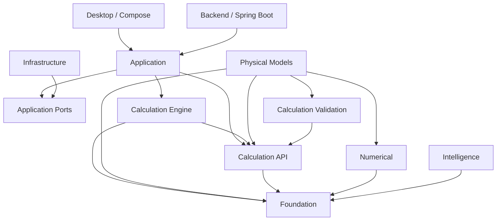

# Thermora Core — Architecture

**Версия документа:** 1.3  
**Статус:** Draft — актуализирован по состоянию на 14.11.2026  
**Платформа вычислительного ядра:** Kotlin/JVM  
**Система сборки:** Gradle Kotlin DSL  
**Архитектурный стиль:** Modular Monolith, Clean Architecture, Hexagonal Architecture  
**Тип системы:** Независимое модульное вычислительное ядро с возможностью локального и серверного выполнения  
**Основная реализация:** Kotlin/JVM 21; экспериментальные высокопроизводительные компоненты Rust — перспективное расширение

---

## Изменения версии 1.2

Версия 1.2 уточняет архитектуру 1.1 без изменения её базовых принципов:

- фиксирует фактически реализованные Gradle-модули и отделяет их от целевой структуры;
- конкретизирует контракт и границы `numerical/solvers`, включая скалярные и векторные итерации;
- вводит требования к численной устойчивости по результатам `NUMERICAL_SOLVERS_AUDIT.md` и запрещает считать прохождение тестов доказательством численной корректности;
- уточняет стратегию воспроизведения исходных Excel-методик, включая известные дефекты и независимую проверку эталонных значений;
- документирует возможную Rust-интеграцию для вычислительно тяжёлых задач и визуализации без переноса существующего Kotlin Core;
- разграничивает UI, инженерную визуализацию, вычислительные модули и серверные сервисы;
- обновляет порядок реализации и критерии готовности к интеграции физических моделей.

**Версия архитектурного документа не равна версии приложения, Calculation API, физической модели или численного алгоритма.**

---

## Изменения версии 1.3

Версия 1.3 развивает документ 1.2, сохраняя его структуру, целевую архитектуру и границы подсистем:

- выделяет проектируемый модуль `:calculation:validation` и определяет его обязанности, API и направление зависимостей;
- фиксирует реализацию первой Legacy-модели, прикладного Core и независимых проверок публичных Gradle API;
- уточняет уже проверенные исправления численных решателей и семантики отмены расчётов;
- разграничивает структурную, универсальную числовую, модельную и пострасчётную инженерную валидацию;
- формирует последовательность ручной реализации модуля Validation с тестами, без преждевременного изменения публичных контрактов.

**Статусы ниже отражают известные результаты предыдущих проверок, а не повторную проверку исходного кода на дату документа.**

---

## 1. Назначение системы

Thermora Core — независимое вычислительное ядро для инженерного анализа тепловых режимов радиоэлектронной аппаратуры.

Основная задача ядра — предоставлять единый механизм для подключения, проверки, выполнения и сравнения различных расчётных моделей.

Ядро должно обеспечивать:

- выполнение тепловых расчётов;
- поддержку нескольких реализаций одной физической задачи;
- валидацию входных параметров;
- контроль численной сходимости;
- диагностику ошибок и предупреждений;
- оценку физической допустимости результатов;
- сравнение результатов различных моделей;
- пакетное выполнение расчётов;
- инженерную оптимизацию параметров;
- воспроизводимость ранее выполненных расчётов;
- версионирование моделей и расчётных алгоритмов;
- расширение системы новыми физическими моделями.

Thermora Core не должен зависеть от конкретного пользовательского интерфейса, базы данных, формата хранения исходных данных или способа запуска приложения.

Ядро должно оставаться работоспособным как самостоятельная библиотека Kotlin/JVM.

### 1.1. Основная архитектурная идея

Вычислительное ядро строится вокруг независимых расчётных моделей.

Каждая модель реализует определённую инженерную задачу и предоставляет стандартизированный интерфейс взаимодействия с вычислительным движком.

Примеры расчётных задач:

- расчёт герметичного корпуса;
- расчёт внутреннего перемешивания;
- расчёт наружного охлаждения;
- расчёт корпуса с оребрением;
- расчёт перфорированного корпуса;
- расчёт корпуса с принудительным охлаждением.

Одна физическая задача может иметь несколько независимых реализаций:

- **Legacy** — воспроизведение существующей расчётной методики;
- **Improved** — альтернативная реализация с документированными физическими зависимостями.

Вычислительный движок не должен знать внутреннее устройство конкретной модели. Он взаимодействует с моделями исключительно через общий Calculation API.

### 1.2. Границы Thermora Core

Необходимо разделять само вычислительное ядро и приложение Thermora в целом.

**Thermora Core** отвечает за физические модели, численные методы и выполнение расчётов.

**Thermora Application** организует пользовательские инженерные сценарии.

**Thermora Desktop** предоставляет настольный интерфейс.

**Thermora Backend** обеспечивает серверный доступ к вычислительным возможностям.

**Thermora Intelligence** предоставляет дополнительные возможности анализа документов, распознавания геометрии, прогнозирования и оптимизации на основе AI/ML.

Эти компоненты взаимодействуют через определённые контракты, но не должны объединяться в один неразделимый программный компонент.

---

## 2. Архитектурные принципы

### 2.1. Независимость вычислительного ядра

Thermora Core не зависит от:

- Compose Desktop;
- Android;
- JavaFX;
- Spring Boot;
- PostgreSQL;
- SQLite;
- Apache POI;
- PDF-библиотек;
- HTTP-клиентов;
- конкретной файловой системы;
- конкретной операционной системы;
- AI/ML runtime.

Взаимодействие с перечисленными технологиями осуществляется через внешние адаптеры и прикладные контракты.

Ядро должно иметь возможность использоваться:

- настольным приложением;
- серверным приложением;
- автоматизированными тестами;
- отдельными инженерными инструментами;
- другими программными системами, которым необходимы тепловые расчёты.

### 2.2. Modular Monolith

На текущем этапе основная система реализуется как модульный монолит.

Модули находятся в одном Gradle-проекте и могут выполняться в рамках одного процесса, но имеют чётко определённые границы ответственности.

Это позволяет:

- сохранять простоту разработки и отладки;
- избегать ненужного сетевого взаимодействия;
- использовать общие JVM-типы;
- контролировать зависимости между компонентами;
- независимо тестировать расчётные модели;
- постепенно расширять систему;
- выделять отдельные компоненты при реальной необходимости.

Использование микросервисной архитектуры на начальном этапе нецелесообразно.

Само наличие нескольких расчётных моделей не требует их независимого сетевого развертывания.

При этом архитектура не должна препятствовать последующему созданию отдельного Backend.

### 2.3. Clean Architecture

Архитектура разделяется на слои, а направление зависимостей направлено внутрь — к контрактам и предметной логике.

Внутренние компоненты не должны зависеть от деталей реализации внешних компонентов.

Например, расчёт герметичного корпуса не должен знать, откуда поступили исходные данные:

- из пользовательской формы;
- из Excel;
- из базы данных;
- через REST API;
- из другого программного приложения.

### 2.4. Hexagonal Architecture

Взаимодействие с внешним миром осуществляется через порты и адаптеры.

Порты определяют необходимые внутренним компонентам операции.

Адаптеры реализуют эти операции с использованием конкретных технологий.

Примеры:

| Порт | Адаптер |
|---|---|
| CalculationHistoryRepository | PostgresCalculationHistoryRepository |
| CalculationGateway | LocalCalculationGateway |
| CalculationGateway | RemoteCalculationGateway |
| DocumentImporter | ExcelDocumentImporter |
| CalculationExporter | PdfCalculationExporter |

Контракты портов не должны зависеть от конкретных библиотек и технологий адаптеров.

### 2.5. Plugin Architecture

Расчётные модели подключаются к системе через единый контракт.

В первой версии подключение выполняется посредством Gradle-модулей и явной регистрации моделей.

Динамическая загрузка внешних JAR-плагинов не входит в начальный объём разработки.

Архитектура должна позволять добавлять новые модели без изменения существующей реализации вычислительного движка.

### 2.6. Разделение физики и численных методов

Необходимо различать три независимые области:

1. Физическая модель.
2. Численный метод решения.
3. Механизм управления выполнением.

Физическая модель определяет зависимости между физическими величинами и условия применимости этих зависимостей.

Численный модуль предоставляет универсальные алгоритмы решения математических задач.

Вычислительный движок управляет жизненным циклом расчёта.

Например, метод бисекции может использоваться несколькими тепловыми моделями, но сам по себе не должен содержать сведений о геометрии корпуса или коэффициенте теплоотдачи.

### 2.7. Детерминированность физических расчётов

Физические расчёты должны оставаться проверяемыми и воспроизводимыми.

Результат расчёта должен определяться:

- входными данными;
- версией физической модели;
- версией алгоритма;
- параметрами численных методов;
- используемыми справочными данными.

AI/ML может помогать анализировать входные данные и предлагать инженерные решения, но не должен незаметно изменять физические формулы или подменять результат детерминированного расчёта.

---

## 3. Общая архитектура системы

Архитектура Thermora разделяется на следующие логические области:

1. Foundation
2. Calculation API
3. Calculation Validation
4. Calculation Engine
5. Numerical
6. Models
7. Application
8. Infrastructure
9. Intelligence
10. Presentation
11. Backend

Не все области являются непосредственной частью Thermora Core.

### 3.1. Foundation

Фундаментальные типы и предметные понятия системы.

Отвечает за:

- общие идентификаторы;
- физические величины;
- единицы измерения;
- базовые геометрические типы;
- материалы;
- общие теплофизические понятия.

Foundation не содержит расчётных алгоритмов.

### 3.2. Calculation API

Публичный программный контракт взаимодействия вычислительного движка и расчётных моделей.

Отвечает за:

- описание расчётных моделей;
- типизированные входные и выходные данные;
- идентификаторы моделей;
- контекст выполнения;
- результаты;
- статусы расчётов;
- диагностические сообщения;
- интерфейсы моделей.

Calculation API не содержит реализаций физических моделей.

Это внутренний Kotlin/JVM API, а не REST API.

### 3.2А. Calculation Validation

`calculation/validation` — библиотека переиспользуемых правил и компоновщиков проверок входных данных. Модуль не является самостоятельным вычислительным движком и не запускает расчёты.

В него входят: композиция правил, общие проверки конечности чисел, знака, диапазонов и отношений величин, а также сбор диагностических сообщений через существующие контракты Calculation API.

**Не входят:** формулы теплопередачи, выбор эмпирических коэффициентов, модельные пределы применимости без источников, обработка результатов решателей, создание UI-сообщений и подавление исключений отмены.

Модель сохраняет собственный `validate(input)` и при необходимости использует библиотеку Validation. Engine вызывает `model.validate(input)` через Calculation API, **не зависит от Validation напрямую** и не знает конкретные правила.

### 3.3. Calculation Engine

Управляет выполнением расчётов.

Отвечает за:

- поиск зарегистрированной модели;
- проверку совместимости входных данных;
- запуск валидации;
- создание контекста выполнения;
- запуск расчётной модели;
- обработку результатов;
- формирование итогового результата.

Calculation Engine не содержит физических формул.

### 3.4. Numerical

Содержит универсальные численные методы:

- Root Finding;
- Bisection Method;
- Newton-Raphson Method;
- Fixed-Point Iteration;
- Interpolation;
- Numerical Integration;
- Linear Algebra;
- Optimization Algorithms;
- Convergence Monitoring.

Численные алгоритмы не должны зависеть от конкретных физических моделей.

### 3.5. Models

Содержит конкретные реализации физических задач.

Каждая модель располагается в отдельном Gradle-модуле и реализует общий контракт Calculation API.

Модели могут использовать общие физические типы Foundation и универсальные алгоритмы Numerical.

### 3.6. Application

Организует выполнение инженерных сценариев.

Отвечает за:

- запуск отдельных расчётов;
- пакетное выполнение;
- сравнение моделей;
- инженерную оптимизацию;
- координацию параллельных вычислений;
- выбор доступных расчётных моделей;
- взаимодействие с внешними портами.

Application не реализует физические формулы.

### 3.7. Infrastructure

Содержит реализации взаимодействия с внешними системами:

- Persistence;
- Serialization;
- Excel Import;
- Export;
- File Storage;
- Remote Calculation Client.

Infrastructure не должна содержать физические формулы.

### 3.8. Intelligence

Независимая подсистема интеллектуального анализа.

Может предоставлять:

- распознавание инженерных чертежей;
- извлечение характеристик из datasheets;
- анализ геометрии;
- прогнозирование температур;
- поиск аномалий;
- оптимизацию конструкций;
- анализ результатов расчётов.

Intelligence не должна становиться обязательной зависимостью Calculation Core.

Если AI-функции недоступны, физическое ядро должно продолжать работать.

### 3.9. Presentation

Пользовательский интерфейс.

Первой реализацией является Compose Desktop.

Presentation отвечает за:

- ввод параметров;
- отображение результатов;
- визуализацию геометрии;
- отображение тепловых процессов;
- отображение диагностических сообщений;
- управление пользовательскими сценариями.

Интерфейс взаимодействует с Application, но не вызывает физические расчётные функции напрямую.

### 3.10. Backend

Отдельная серверная точка входа в систему.

Предполагаемая реализация — Java + Spring Boot.

Backend обеспечивает:

- REST API;
- авторизацию;
- управление пользователями;
- лицензирование;
- серверное выполнение расчётов;
- доступ к истории расчётов;
- взаимодействие с базой данных;
- предоставление возможностей Thermora другим приложениям.

Backend использует JVM-модули Thermora Core как обычные зависимости.

Он не должен содержать дублирующие реализации физических моделей.

---

## 4. Структура Gradle-проекта

Ниже представлена целевая логическая структура Thermora.

Она не является требованием немедленно создать все перечисленные каталоги и Gradle-модули.

```text
thermora/
│
├── settings.gradle.kts
├── build.gradle.kts
├── gradle.properties
│
├── foundation/
│   ├── common/
│   ├── units/
│   └── domain/
│
├── calculation/
│   ├── api/
│   ├── validation/
│   └── engine/
│
├── numerical/
│   ├── linear-algebra/
│   ├── optimization/
│   ├── interpolation/
│   └── solvers/
│
├── models/
│   ├── sealed-housing-legacy/
│   ├── internal-mixing-legacy/
│   ├── external-cooling-legacy/
│   ├── finned-housing-legacy/
│   ├── perforated-housing-legacy/
│   ├── forced-cooling-legacy/
│   │
│   ├── sealed-housing-improved/
│   ├── internal-mixing-improved/
│   └── external-cooling-improved/
│
├── application/
│   ├── core/
│   └── ports/
│
├── infrastructure/
│   ├── persistence/
│   ├── serialization/
│   ├── excel-import/
│   ├── export/
│   ├── model-storage/
│   └── remote-calculation/
│
├── intelligence/
│   ├── api/
│   ├── hardware/
│   │   ├── detection/
│   │   ├── profiling/
│   │   └── capability-evaluation/
│   ├── runtime/
│   │   ├── model-manager/
│   │   ├── execution-manager/
│   │   └── resource-manager/
│   ├── inference/
│   │   ├── cpu/
│   │   └── gpu/
│   ├── models/
│   │   ├── thermal-prediction/
│   │   ├── geometry-recognition/
│   │   └── optimization/
│   └── document-analysis/
│
├── desktop/
│   └── compose-app/
│
├── backend/
│   └── server/
│       └── src/
│           ├── main/
│           │   ├── java/
│           │   │   └── com/thermora/server/
│           │   │       ├── controller/
│           │   │       ├── service/
│           │   │       ├── dto/
│           │   │       ├── security/
│           │   │       ├── licensing/
│           │   │       └── config/
│           │   └── resources/
│           └── test/
│
├── docs/
│
└── tests/
    ├── compile-smoke/      # отдельная composite Gradle-сборка
    ├── integration/
    ├── benchmarks/
    └── reference-calculations/
```

### 4.0. Известное состояние реализации на 14.11.2026

Ниже зафиксированы результаты ранее выполненных сборок и тестов. Состояние текущей рабочей копии необходимо проверять отдельно.

| Gradle-модуль | Состояние | Примечание |
|---|---|---|
| `:foundation:common` | Базовая реализация | Общие результаты и диагностика |
| `:foundation:units` | Базовая реализация | Размерности, SI, температуры и тесты |
| `:foundation:domain` | Базовая реализация | Общие теплофизические предметные типы |
| `:calculation:api` | Базовая реализация | Контракты моделей; исправлен экспорт публичной зависимости C-01 |
| `:calculation:engine` | Базовая реализация | Реестр и выполнение; C-02 — проброс отмены и прерывания |
| `:calculation:validation` | **Запланирован** | Следующий модуль для самостоятельной реализации |
| `:numerical:solvers` | Реализован и регрессионно протестирован | Ранее подтверждено 96 проходящих тестов; исходный аудит P0 не описывает текущее состояние |
| `:models:sealed-housing-legacy` | Первая модель реализована | Excel-совместимость контрольного сценария; остаются численные вопросы D-01/D-02, если не исправлены отдельно |
| `:application:core` | Базовая реализация | Запуск модели через Core; тесты семантики отмены |
| `tests/compile-smoke` | Отдельная Gradle-сборка | Шесть внешних потребителей проверяют доступность публичных типов |

По предыдущим проверкам после C-01/C-02 проходили **236 тестов** основной сборки и все шесть compile-smoke потребителей. Это исторический результат, не гарантия текущей сборки.

Остальные целевые модули не считаются реализованными только на основании наличия их в документации.

### 4.1. Принцип организации модулей

Каждый каталог верхнего уровня представляет отдельную архитектурную область.

Вложенные каталоги не обязательно являются отдельными Gradle-модулями.

Например, `numerical/solvers` может быть одним Gradle-модулем, внутри которого находятся пакеты для разных алгоритмов.

Выделять отдельный Gradle-модуль следует тогда, когда это даёт реальную пользу:

- независимое управление зависимостями;
- отдельное тестирование;
- повторное использование;
- независимое развитие;
- чёткую границу ответственности.

Не следует создавать большое количество мелких модулей только ради формального разделения пакетов.

### 4.2. foundation/common

Содержит базовые типы, используемые несколькими внутренними модулями:

- идентификаторы;
- общие технические типы;
- базовые исключения;
- простые общие абстракции.

Не должен становиться хранилищем произвольных утилит.

### 4.3. foundation/units

Отвечает за физические величины и единицы измерения.

Примеры:

- Length;
- Area;
- Volume;
- Temperature;
- TemperatureDifference;
- Pressure;
- Power;
- ThermalConductivity;
- HeatTransferCoefficient;
- ThermalResistance.

Внутреннее представление физических величин использует SI.

Преобразования единиц должны быть явными и проверяемыми.

Абсолютная температура и разность температур должны рассматриваться как разные физические типы там, где этого требует математический смысл операций.

### 4.4. foundation/domain

Содержит общие предметные понятия:

- Material;
- Geometry;
- AmbientConditions;
- ThermalBoundaryCondition.

В этот модуль включаются только понятия, обладающие единым физическим смыслом для нескольких моделей.

Специфические параметры конкретной расчётной задачи остаются внутри соответствующего модельного модуля.

### 4.5. calculation/api

Содержит публичные контракты:

- `CalculationModel`;
- `ModelDescriptor`;
- `ModelId`;
- `CalculationContext`;
- `ModelExecution`;
- `CalculationResult`;
- `CalculationStatus`;
- `Diagnostic`;
- `ValidationReport`.

API определяет правила взаимодействия моделей и вычислительного движка.

API не должен содержать конкретные реализации моделей или численных алгоритмов.

### 4.6. calculation/engine

Реализует:

- `CalculationEngine`;
- механизм регистрации моделей;
- разрешение модели по идентификатору;
- проверку совместимости типов;
- управление жизненным циклом расчёта;
- обработку ожидаемых ошибок выполнения.

Механизм регистрации является частью реализации Engine.

Публичные контракты, необходимые для взаимодействия с ним, размещаются в Calculation API.

### 4.6А. calculation/validation

Предоставляет общие строительные блоки для проверок, которые могут переиспользовать разные модели. Планируемые компоненты:

- `ValidationRule<I>` — типизированная проверка одного входного объекта;
- `CompositeValidator<I>` — последовательный запуск набора правил с детерминированным порядком диагностик;
- общие числовые правила — конечность, знак, диапазон и сравнение двух значений;
- преобразование результатов правил в существующий `ValidationReport`, без дублирования `Diagnostic`.

Точные сигнатуры согласуются с **фактическими** типами `ValidationReport` и `Diagnostic` в исходном коде до реализации. Нельзя вводить вторую несовместимую модель диагностики.

Правила должны быть без побочных эффектов и не изменять входные данные. Ожидаемые нарушения возвращаются диагностикой, а не скрываются исключениями. `CancellationException` и `InterruptedException` не должны поглощаться валидаторами.

### 4.7. numerical

Содержит независимые численные алгоритмы.

Модель может использовать несколько численных методов, если это соответствует её математической постановке.

Numerical не должен зависеть от Application, Infrastructure или Presentation.

### 4.8. models

Каждая физическая модель располагается в отдельном Gradle-модуле.

Пример:

```text
sealed-housing-legacy/
│
├── src/
│   ├── main/
│   │   └── kotlin/
│   │       └── ...
│   │
│   └── test/
│       └── kotlin/
│           └── ...
│
└── build.gradle.kts
```

Внутри модели размещаются:

- типы входных данных;
- типы выходных данных;
- предметная валидация;
- физические зависимости;
- расчётные алгоритмы;
- адаптация численных методов;
- диагностика специфических физических ограничений;
- тесты.

Не требуется искусственно создавать отдельный Gradle-модуль для каждого внутреннего пакета модели.

### 4.9. application/core

Содержит прикладные сценарии:

- запуск расчёта;
- сравнение моделей;
- пакетное выполнение;
- оптимизация;
- координация вычислений;
- управление доступными моделями.

Application использует Calculation API и Calculation Engine через определённые контракты.

### 4.10. application/ports

Содержит интерфейсы внешних операций, необходимых прикладному слою.

Примеры:

- `CalculationHistoryRepository`;
- `CalculationGateway`;
- `CalculationExporter`;
- `DocumentImporter`.

Порты принадлежат внутреннему слою, который определяет потребность в соответствующей операции.

Конкретные реализации располагаются в Infrastructure или других внешних модулях.

### 4.11. infrastructure

Реализует внешние механизмы хранения и обмена данными.

Например:

```text
persistence/
├── CalculationHistoryRepository
└── postgres/
    └── PostgresCalculationHistoryRepository
```

Infrastructure может зависеть от внутренних контрактов Application, которые она реализует.

Обратная зависимость Application от конкретных Infrastructure-адаптеров запрещена.

### 4.12. desktop/compose-app

Содержит Compose Desktop-приложение.

Модуль отвечает за пользовательский интерфейс и интеграцию с Application.

Внутри него не должны находиться:

- физические формулы;
- реализации расчётных моделей;
- численные методы;
- логика регистрации физических моделей;
- SQL-запросы к базе данных.

### 4.13. backend/server

Отдельное Java-приложение на Spring Boot.

Backend подключает необходимые Kotlin/JVM-модули как зависимости.

Предполагаемые обязанности:

- REST Controllers;
- DTO;
- Services;
- Security;
- Licensing;
- Configuration;
- серверная интеграция с Application и Calculation Engine.

Backend является внешней точкой входа, а не частью физического ядра.

### 4.14. intelligence

Содержит независимые AI/ML-компоненты.

Разделение на API, Hardware, Runtime, Inference и специализированные модели позволяет независимо управлять интеллектуальными возможностями.

Аппаратная оценка должна определять доступность конкретных функций, а не отключать всю подсистему при недостатке ресурсов для одной модели.

---

## 5. Граф зависимостей

Основное правило: зависимости направлены от внешних компонентов к внутренним контрактам.



Схема отражает логические зависимости. Конкретные Gradle-зависимости могут отличаться в зависимости от способа сборки приложения.

### 5.1. Разрешённые зависимости

| Модуль | Может зависеть от |
|---|---|
| foundation/common | Стандартная библиотека |
| foundation/units | foundation/common |
| foundation/domain | foundation/common, foundation/units |
| calculation/api | Foundation |
| calculation/engine | calculation/api, Foundation |
| calculation/validation | calculation/api; Foundation — только при доказанной необходимости |
| numerical | Foundation |
| models/* | calculation/api, Foundation, numerical, calculation/validation (опционально) |
| application/core | calculation/api, calculation/engine, Application Ports |
| application/ports | Внутренние контракты |
| infrastructure/* | Контракты, которые реализует адаптер |
| desktop/compose-app | application/core, Compose |
| backend/server | application/core, необходимые JVM-модули, Spring Boot |
| intelligence/* | Собственные API и необходимые общие контракты |

### 5.2. Композиция приложения

Необходимо выделять Composition Root — место, в котором создаются и связываются конкретные реализации компонентов.

Например, именно при сборке Desktop или Backend-конфигурации определяются:

- какие физические модели доступны;
- какие адаптеры хранения используются;
- какой CalculationGateway применяется;
- какие AI-функции подключены.

Это позволяет не помещать конкретные реализации моделей и инфраструктуры внутрь Calculation Engine.

### 5.3. Запрещённые зависимости

- Foundation не зависит от Calculation, Application, Infrastructure или Presentation.
- Calculation API не зависит от Engine и конкретных моделей.
- Calculation Engine не зависит от конкретных физических моделей и от `calculation/validation`; он вызывает `CalculationModel.validate`.
- Calculation Validation не зависит от Engine, моделей, Numerical, Application и UI.
- Numerical не зависит от моделей и Application.
- Модели не зависят от Compose, Spring Boot, БД и Excel-библиотек.
- Application не зависит от конкретных реализаций Infrastructure.
- Presentation не содержит физическую расчётную логику.
- Intelligence не является обязательной зависимостью Calculation Core.
- Backend не содержит собственных копий физических алгоритмов.

---

## 6. Архитектура расчётных моделей

### 6.1. Единый контракт

Каждая модель реализует общий интерфейс:

```kotlin
interface CalculationModel<I : Any, O : Any> {

    val descriptor: ModelDescriptor

    fun validate(input: I): ValidationReport

    fun calculate(
        input: I,
        context: CalculationContext
    ): ModelExecution<O>
}
```

Типы `I` и `O` определяются конкретной моделью.

Например:

```kotlin
data class SealedHousingInput(
    // Параметры конкретной модели
)

data class SealedHousingOutput(
    // Результаты конкретной модели
)
```

Этот пример не фиксирует окончательный состав физических параметров. Он определяется на основании аудита исходных расчётных методик.

Контракт может уточняться по мере развития API, но его изменения должны быть документированы и версионированы.

### 6.2. Идентификаторы моделей

Каждая реализация получает стабильный уникальный идентификатор.

Примеры:

```text
thermora.sealed-housing.legacy
thermora.sealed-housing.improved

thermora.internal-mixing.legacy
thermora.external-cooling.legacy
```

Идентификатор не должен зависеть от имени Kotlin-класса или отображаемого названия модели.

### 6.3. Model Descriptor

Дескриптор описывает модель и её возможности.

Предполагаемые поля:

- Model ID;
- отображаемое название;
- описание;
- версия модели;
- версия алгоритма;
- версия схемы входных данных;
- версия схемы выходных данных;
- поддерживаемые возможности;
- ограничения применимости.

Дескриптор не должен содержать сами расчётные данные.

### 6.4. Legacy

Legacy — программная реализация существующих расчётных методик.

Основные требования:

- воспроизведение исходной логики Excel;
- сохранение исторических особенностей расчёта;
- фиксация известных ошибок и неоднозначностей;
- покрытие контрольными тестами;
- сохранение возможности сравнения с исходными результатами.

Обнаруженные ошибки не должны незаметно исправляться в Legacy.

Если исправление изменяет вычислительное поведение, оно должно быть явно задокументировано и отражено в версии алгоритма.

### 6.5. Improved

Improved — отдельная реализация физической задачи.

Она должна использовать обоснованные физические зависимости и документированные предпосылки.

Для каждой Improved-модели необходимо фиксировать:

- источники используемых зависимостей;
- область применимости;
- допущения;
- граничные условия;
- ограничения;
- критерии достоверности результата;
- используемые численные методы.

Неизвестное происхождение эмпирической формулы не является основанием считать её физически корректной.

### 6.6. Сравнение моделей

Legacy и Improved не должны вызывать друг друга.

Их сравнение выполняется на уровне Application.

Application формирует общий сценарий, запускает обе реализации и сопоставляет физически совместимые результаты.

Сравнение возможно только при:

- одинаковом физическом смысле сравниваемых величин;
- сопоставимых входных условиях;
- корректных единицах измерения;
- согласованных граничных условиях;
- документированных различиях в предпосылках моделей.

Различия между результатами не следует автоматически считать ошибкой одной из моделей.

---

## 7. Calculation Engine

Calculation Engine — центральный механизм выполнения расчётов.

Его ответственность ограничивается управлением вычислительным процессом.

### 7.1. Жизненный цикл расчёта

```text
Calculation Request
        |
        v
Resolve Model
        |
        v
Check Input Compatibility
        |
        v
Validate Input
        |
        +---- Invalid ----> INVALID_INPUT
        |
        v
Create Execution Context
        |
        v
Execute Calculation Model
        |
        v
Process Model Execution
        |
        v
Create Calculation Result
        |
        v
Return Result
```

### 7.2. Основные обязанности

1. Найти модель по идентификатору.
2. Проверить совместимость входных данных.
3. Выполнить валидацию.
4. Создать контекст выполнения.
5. Запустить модель.
6. Обработать ожидаемые вычислительные исходы.
7. Сформировать единый результат.
8. Передать результат вызывающему Application.

### 7.2А. Интеграция Validation

1. Engine проверяет существование модели и совместимость типа входа.
2. Engine вызывает `CalculationModel.validate(input)` ровно по существующему контракту.
3. Модель выполняет собственные физические проверки и, по необходимости, делегирует общие проверки правилам из `calculation/validation`.
4. Ошибки уровня `ERROR` препятствуют запуску расчёта; `WARNING` и `INFO` сохраняются как диагностика согласно действующему контракту результатов.
5. После расчёта модель может отдельно оценивать физическую допустимость результата: это не замена проверке входа.

Механизм не должен изменять значения входных параметров, автоматически «исправлять» формулы Legacy или придумывать допустимые инженерные диапазоны без источника.

### 7.3. Реестр моделей

Реестр отвечает за доступность зарегистрированных расчётных моделей.

Предполагаемые операции:

- регистрация модели;
- получение модели по Model ID;
- получение списка доступных моделей;
- проверка наличия модели;
- обнаружение повторной регистрации идентификаторов.

Реестр не должен самостоятельно загружать физические модели из файловой системы или искать их через сеть.

Регистрация выполняется в Composition Root приложения.

### 7.4. Типобезопасность

Взаимодействие с моделями должно сохранять связь между конкретным типом входных данных и соответствующей моделью.

Нельзя допускать, чтобы произвольный объект передавался модели без проверки совместимости.

Реализация Registry и Engine должна скрывать внутренние механизмы приведения типов от вызывающего кода.

Конкретная стратегия типобезопасной регистрации определяется при реализации Calculation API.

### 7.5. Что не входит в обязанности Engine

Engine не должен:

- самостоятельно выбирать физические формулы;
- рассчитывать теплопроводность;
- определять геометрию корпуса;
- выполнять инженерную оптимизацию;
- обращаться к БД;
- читать Excel;
- отправлять HTTP-запросы;
- отображать результаты.

---

## 8. Numerical Engine

Численные методы выделяются в самостоятельную область, поскольку могут использоваться различными физическими моделями.

Предполагаемые алгоритмы:

| Алгоритм | Назначение |
|---|---|
| Bisection | Поиск корня на интервале |
| Newton-Raphson | Итерационный поиск корня |
| Fixed-Point Iteration | Решение уравнений методом простой итерации |
| Interpolation | Интерполяция табличных данных |
| Numerical Integration | Численное интегрирование |
| Linear Algebra | Операции с матрицами и векторами |
| Optimization | Универсальные алгоритмы оптимизации |
| Convergence Monitor | Контроль сходимости |

Для каждого метода необходимо определить:

- критерии остановки;
- максимальное число итераций;
- численные допуски;
- условия применимости;
- обработку некорректных значений;
- диагностику отсутствия сходимости.

Численные допуски должны учитывать физический смысл и размерность вычисляемой величины.

Не следует использовать один универсальный абсолютный допуск для температуры, мощности и теплового сопротивления.

Numerical не должен принимать решения о физической допустимости инженерного результата. Это ответственность соответствующей физической модели и прикладного слоя.

---

### 8.1. Numerical API и исторический аудит

Модуль `:numerical:solvers` предоставляет математические алгоритмы, независимые от тепловых моделей, Excel, UI и инфраструктуры:

| Компонент | Назначение | Состояние |
|---|---|---|
| `QuadraticSolver` | Действительные корни квадратного и вырожденного линейного уравнения | Реализован; дефекты P0 из исходного аудита проверялись и исправлялись позднее |
| `FixedPointSolver` | Скалярная итерация с релаксацией | Реализован; дефекты P0 из исходного аудита проверялись и исправлялись позднее/P1 |
| `VectorFixedPointSolver` | Покомпонентная векторная итерация с масштабами | Реализован; дефекты P0 из исходного аудита проверялись и исправлялись позднее/P1 |
| `IterativeSolverOptions` | Допуски, лимит итераций, релаксация | Базовый контракт реализован |
| `SolverResult<T>` / `SolverStatus` | Значение, статус, число итераций, нормы невязки и шага | Базовый контракт реализован, семантика уточняется |

Результат `SolverResult` описывает **численный исход**. Он не заменяет `CalculationResult` и не доказывает физическую допустимость полученной температуры или теплового баланса. Адаптация статусов и диагностик выполняется физической моделью и Calculation API.

`QuadraticRoots.None` означает отсутствие действительных корней, `QuadraticRoots.Infinite` — тождественное уравнение; успешная классификация не означает наличие единственного физически допустимого решения. Выбор физического корня остаётся в модели.

### 8.2. Численная устойчивость и критерии приёмки

Исторический аудит `docs/NUMERICAL_SOLVERS_AUDIT.md` (13.11.2026) выявил перечисленные дефекты при 20 проходящих тестах. **Таблица сохраняется как история аудита, а не как перечень текущих неисправленных ошибок**: позднее сообщалось о 96 проходящих тестах после исправлений.

| ID | Суть | Приоритет |
|---|---|---|
| NS-01 | Успешный результат с NaN/Infinity в числовом корне | P0 |
| NS-02 | Потеря существенных коэффициентов при нормализации и underflow | P0 |
| NS-03 | Ошибочная классификация корней из-за округления дискриминанта | P0 |
| NS-04 | Ложная сходимость при бесконечных промежуточных нормах/допусках | P0 |
| NS-06 | Изменяемый извне массив `scales` нарушает изоляцию расчёта | P0 |
| NS-05 | Переполнение разности при вычислении представимого релаксированного шага | P1 |

Обязательные правила для Numerical:

1. `CONVERGED` не допускается, если найденные числовые корни, необходимые диагностические нормы или проверяемые условия сходимости недостоверны. Сравнение `Infinity <= Infinity` не должно давать успех.
2. Нельзя заменять малые ненулевые коэффициенты нулём произвольным epsilon. При сложных масштабах требуется устойчивая арифметика и, при необходимости, высокоточный fallback.
3. Невязка должна относиться к возвращаемой точке; проверяются **и шаг, и дефект неподвижной точки** в явно заданных допусках. Это не эквивалент проверки физического теплового баланса.
4. Для векторных величин масштабирование и единицы задаются вызывающей моделью. `scales` фиксируются локальным снимком до вычислений; изменяемость массивов в результатах должна иметь документированный контракт владения.
5. Неверная размерность вектора, неконечная арифметика, некорректные параметры, исключение callback, отсутствие сходимости и математическая расходимость — разные причины. Их нельзя безоговорочно сводить к одному статусу.
6. Чистота и детерминированность `update`, семантика `iterations`, число вычислений функции и правила обработки исключений должны быть описаны до стабилизации публичного API.
7. `DIVERGED` не является доказуемым диагнозом по произвольному конечному префиксу итераций. Эвристики ранней остановки допускаются только с документированными ограничениями; точная стагнация может определяться отдельно.
8. Все подтверждённые дефекты сопровождаются регрессионными тестами, в том числе на экстремальные `Double`, subnormal, переполнение и некорректные масштабы.

**Критерий допуска Numerical к использованию в новых физических моделях:** устранены все подтверждённые P0, соответствующие регрессионные тесты проходят, контракты результата и ошибки документированы. P1/P2 оцениваются по требованиям конкретной модели; наличие проходящей сборки само по себе недостаточно.

### 8.3. Приоритеты остальных численных модулей

- `numerical/solvers` — P0; текущий предмет разработки.
- `numerical/interpolation` — P1 при появлении подтверждённой задачи табличной интерполяции.
- `numerical/linear-algebra` — P1/P2, когда потребуются матричные задачи, нелинейные системы или аппроксимация.
- `numerical/optimization` — P2, после определения целевых функций, переменных и ограничений.

Не следует реализовывать весь каталог численных алгоритмов до появления проверяемой потребности.

---

## 9. Application Layer

Application организует инженерные сценарии и связывает внутренние компоненты системы.

Он не содержит физических формул и не должен зависеть от конкретных технологий хранения или пользовательского интерфейса.

### 9.1. Основные сценарии

Предполагаемые прикладные операции:

- Execute Calculation;
- Execute Batch;
- Compare Models;
- Optimize Design;
- Get Available Models;
- Get Calculation History;
- Recalculate Previous Result.

Конкретный набор Use Cases определяется по мере появления соответствующей функциональности.

### 9.2. Calculation Gateway

Для отделения прикладных сценариев от конкретного способа выполнения расчёта используется абстракция `CalculationGateway`.

Она позволяет одному приложению работать с локальным или удалённым вычислительным ядром.

Пример концептуального интерфейса:

```kotlin
interface CalculationGateway {

    suspend fun calculate(
        request: ThermalCalculationRequest
    ): ThermalCalculationResult
}
```

Возможные реализации:

**LocalCalculationGateway**

Выполняет расчёт непосредственно через локальный Calculation Engine.

**RemoteCalculationGateway**

Передаёт запрос серверному Backend через HTTP API и возвращает полученный результат.

Application и Presentation работают с единым контрактом и не должны содержать условную логику, зависящую от конкретного способа выполнения расчёта.

### 9.3. Локальный режим

В локальном режиме:

```text
Desktop UI
    |
    v
Application
    |
    v
LocalCalculationGateway
    |
    v
Calculation Engine
    |
    v
Physical Models
```

Расчёты выполняются на устройстве пользователя.

Наличие Backend не требуется.

### 9.4. Удалённый режим

В удалённом режиме:

```text
Desktop UI
    |
    v
Application
    |
    v
RemoteCalculationGateway
    |
    v
HTTP REST API
    |
    v
Spring Boot Backend
    |
    v
Calculation Engine
    |
    v
Physical Models
```

В этом случае вычисления выполняются на сервере.

### 9.5. Общие требования к Gateway

Обе реализации должны обеспечивать единое прикладное поведение.

Необходимо учитывать:

- ошибки выполнения;
- отмену расчёта;
- таймауты;
- сетевые ошибки;
- несовместимость версий API;
- сериализацию и десериализацию данных;
- передачу диагностических сообщений.

Локальное и удалённое выполнение не обязаны использовать один и тот же транспортный формат.

Внутренний Calculation API и внешний REST API являются разными контрактами.

### 9.6. Пакетное выполнение

Batch Execution позволяет запускать несколько расчётов в рамках одного сценария.

Примеры:

- сравнение разных геометрических параметров;
- расчёт нескольких вариантов охлаждения;
- сравнение Legacy и Improved;
- исследование влияния мощности тепловыделения.

Application отвечает за координацию задач и сбор результатов.

### 9.7. Оптимизация

Оптимизация является прикладным сценарием.

Numerical предоставляет численные алгоритмы, а Application формирует инженерную задачу:

- целевую функцию;
- переменные проектирования;
- ограничения;
- допустимые диапазоны;
- критерии выбора результата.

Успешное выполнение численного алгоритма не означает, что полученный инженерный вариант физически допустим.

---

## 10. Параллельное выполнение

Параллельное выполнение организуется на уровне Application, а не внутри отдельных моделей без необходимости.

Это позволяет централизованно контролировать:

- количество одновременно выполняемых расчётов;
- использование процессорных ресурсов;
- отмену задач;
- сбор результатов;
- обработку ошибок отдельных задач.

Для Kotlin/JVM предполагается использование Kotlin Coroutines.

` suspend` сам по себе не гарантирует параллельное выполнение. Политика диспетчеризации и ограничения параллелизма должны задаваться явно.

Также необходимо учитывать, что численные расчёты часто являются CPU-bound задачами.

Их выполнение не должно блокировать UI-поток или ограничивать обработку сетевых запросов.

Для длительных серверных расчётов в будущем может потребоваться отдельный механизм асинхронных заданий:

1. Backend принимает запрос.
2. Создаёт идентификатор задания.
3. Передаёт его вычислительному механизму.
4. Клиент получает идентификатор задания.
5. Клиент проверяет состояние выполнения.
6. Backend предоставляет готовый результат.

Такой механизм не требуется внедрять до появления реальной необходимости.

---

## 11. Intelligence Subsystem

Intelligence — независимая подсистема интеллектуального анализа и обработки инженерных данных.

Она не является обязательной частью Calculation Core.

### 11.1. Назначение

Возможные направления:

**Geometry Recognition**

Распознавание геометрии и элементов инженерных чертежей.

**Document Analysis**

Извлечение характеристик компонентов из PDF, datasheets и других документов.

**Thermal Prediction**

Прогнозирование температурных характеристик на основе обученных моделей.

**Optimization Assistance**

Поиск перспективных конструктивных вариантов.

**Result Analysis**

Обнаружение аномалий и анализ результатов физических расчётов.

### 11.2. Граница ответственности AI

AI может:

- распознавать;
- классифицировать;
- извлекать данные;
- анализировать;
- прогнозировать;
- предлагать варианты;
- помогать оптимизировать.

Финальный проверяемый инженерный расчёт выполняется детерминированной физической моделью.

Прогноз ML не должен автоматически представляться как результат физического расчёта.

### 11.3. Hardware Capability Evaluation

Доступность AI-функций должна определяться с учётом аппаратных возможностей устройства.

Необходимо учитывать:

- количество CPU-ядер;
- доступную оперативную память;
- графический процессор;
- доступную VRAM;
- поддерживаемые инструкции;
- совместимость runtime;
- требования конкретной модели.

Оценка должна выполняться для каждой AI-функции отдельно.

Недостаток ресурсов для одной модели не должен отключать все остальные возможности Intelligence.

### 11.4. Режимы исполнения

Предполагаемые режимы:

```kotlin
enum class AIExecutionMode {
    DISABLED,
    CPU,
    GPU,
    REMOTE
}
```

- `DISABLED` — функция недоступна;
- `CPU` — локальное выполнение на процессоре;
- `GPU` — локальное выполнение на графическом процессоре;
- `REMOTE` — удалённое выполнение.

### 11.5. Обучение и выполнение моделей

Обучение моделей и их выполнение на пользовательском устройстве являются разными процессами.

Обучение может выполняться в отдельном исследовательском или серверном окружении.

В Desktop-сборку включаются только необходимые runtime-компоненты и обученные веса моделей.

Обучение нейросетей при каждом запуске Thermora не предусматривается.

---

## 11А. Высокопроизводительные вычисления и гибридный Desktop

### 11А.1. Разделение ответственности Kotlin и Rust

**Kotlin/JVM остаётся основным и обязательным ядром**: физические модели, единицы, Calculation API, управление выполнением и базовые численные решатели. Переписывание существующих Excel-формул на Rust не является целью версии 1.2.

Rust рассматривается как **опциональный вычислительный ускоритель** для задач, в которых профилирование подтвердит выигрыш: расчёты больших температурных полей, сеточные/пространственные модели, обработка крупных массивов, геометрические операции и подготовка данных для визуализации. Ускорение не предполагается без измерений.

Возможная схема:

```text
Desktop / Backend
       |
       v
Application -> Calculation API / Engine -> Kotlin Physical Models
                                              |
                                              v
                                       Numerical / compute port
                                              |
                                  +-----------+-----------+
                                  |                       |
                             Kotlin/JVM             Rust native adapter
                             implementation          (optional)
```

Физическая модель обращается к абстракции вычислительной операции, если действительно существует несколько реализаций. Нативные структуры, указатели, FFI и ошибки Rust не должны проникать в публичный Calculation API. Конкретный способ интеграции (JNI, JNA, Panama FFM или другой мост) выбирается после прототипа и тестов совместимости.

Для нативного ускорителя обязательны: эталонная JVM-реализация или независимый oracle, численная проверка, воспроизводимые входы, контроль владения памятью, обработка ошибок, поддержка целевых ОС/архитектур и сравнение производительности с учётом стоимости перехода через FFI.

### 11А.2. Гибридный пользовательский интерфейс

Базовым UI остаётся `desktop/compose-app` на Compose Desktop. Под «гибридным интерфейсом» понимается возможность встроить специализированный нативный компонент визуализации/рендеринга для инженерного полотна, если возможности Compose недостаточны. Это **не** означает обязательный переход всего приложения на Qt.

Разделение:

- Compose — формы, панели, сценарии, таблицы, история, настройки и диагностика;
- инженерное полотно — геометрия, слои, температурные зоны, интерактивная визуализация; конкретный renderer выбирается отдельно;
- Kotlin Application — состояние сценария, запуск расчёта, координация UI и результатов;
- Rust (опционально) — тяжёлые вычисления и подготовка геометрических/полевых данных, но не автоматическая замена UI и физической модели.

Импорт PDF/PNG-схем, распознавание объектов и анимация тепловых зон — разные функции. Изображение или PDF не содержит само по себе достаточных физических данных для достоверного теплового расчёта; недостающие геометрические, материальные и граничные параметры требуют явного ввода, извлечения с проверкой либо обоснованной оценки.

### 11А.3. Режимы исполнения

Локальный Desktop должен сохранять возможность работать без Backend в пределах установленного набора моделей. Серверное выполнение через `RemoteCalculationGateway` — альтернативный путь. Наличие нативного ускорителя или AI не должно быть обязательным условием работы базовых детерминированных расчётов.

---

## 12. Backend Architecture

Backend представляет собой отдельное серверное приложение, использующее возможности Thermora Core.

Предполагаемая технология — Java + Spring Boot.

### 12.1. Взаимодействие с Kotlin Core

Kotlin/JVM и Java работают в рамках одной JVM-платформы.

Java Backend может подключать Kotlin-модули как обычные Gradle-зависимости.

Например:

```java
@Service
public class ThermalCalculationService {

    private final ThermalCalculationEngine engine;

    public ThermalCalculationService(
            ThermalCalculationEngine engine
    ) {
        this.engine = engine;
    }

    public ThermalCalculationResult calculate(
            ThermalCalculationRequest request
    ) {
        return engine.calculate(request);
    }
}
```

Приведённый пример иллюстрирует взаимодействие Java и Kotlin. Фактические имена интерфейсов и типов определяются окончательным Calculation API.

### 12.2. Разделение контрактов

Необходимо различать:

- внутренний Kotlin Calculation API;
- публичный REST API;
- внутренние Domain-модели.

Backend не должен напрямую раскрывать внутренние Domain-объекты через REST.

Для внешнего API используются отдельные DTO.

Это позволяет независимо изменять внутреннюю архитектуру и публичный контракт сервера.

### 12.3. Ответственность Backend

Backend может обеспечивать:

- REST Controllers;
- авторизацию и аутентификацию;
- управление пользователями;
- лицензирование;
- хранение истории расчётов;
- управление серверными задачами;
- доступ к расчётным моделям;
- интеграцию с внешними системами.

При этом физические алгоритмы остаются в Kotlin Core.

### 12.4. Независимость Backend

Thermora Core должен оставаться работоспособным без Spring Boot.

Spring Boot является способом предоставления серверного доступа к ядру, а не обязательной технологической зависимостью самого ядра.

---

## 13. Версионирование и воспроизводимость

Каждый расчёт должен сохранять сведения, необходимые для его последующего воспроизведения.

Минимальный состав метаданных:

```text
Calculation ID
Model ID
Model Version
Algorithm Version
Input Schema Version
Output Schema Version
Calculation API Version
Thermora Core Version
Input Snapshot
Output Snapshot
Diagnostics
Numerical Options
Reference Data Versions
Execution Timestamp
```

### 13.1. Версионирование модели

Версия модели отражает изменения её контракта и предметного поведения.

### 13.2. Версия алгоритма

Версия алгоритма отражает изменения расчётной логики, корреляций и численных процедур, которые могут влиять на результат.

### 13.3. Версия Core API

Версия API отражает совместимость контрактов между движком и моделями.

### 13.4. Версия схемы данных

Версии схем входных и выходных данных должны учитываться отдельно.

Изменение внутренней реализации модели не всегда требует изменения схемы её входных данных.

### 13.5. Воспроизводимость

Для повторного выполнения должны быть доступны:

- исходный снимок входных данных;
- версия модели;
- версия алгоритма;
- версия численных настроек;
- версия справочных данных;
- необходимые параметры выполнения.

Если расчёт зависит от внешней таблицы, базы материалов или другого изменяемого источника, необходимо сохранять версию либо снимок использованных данных.

Повторный расчёт должен использовать исходные версии компонентов, если требуется строгое воспроизведение исторического результата.

---

## 14. Диагностика и физическая допустимость

Необходимо разделять три независимых аспекта:

1. Корректность входных данных.
2. Успешность вычислительного процесса.
3. Физическая допустимость результата.

Например, численный алгоритм может успешно найти решение, при котором температура корпуса превышает допустимый предел материала.

В таком случае вычисление завершилось успешно, но инженерный результат недопустим.

Поэтому статус выполнения расчёта не должен смешиваться с оценкой физической допустимости.

### 14.1. Диагностика

Диагностическое сообщение должно содержать:

- машинный код;
- уровень серьёзности;
- описание;
- источник сообщения;
- при необходимости ссылку на конкретное поле входных данных;
- при необходимости ссылку на этап расчёта.

### 14.2. Уровни диагностики

В действующей базовой диагностике используются уровни:

- INFO;
- WARNING;
- ERROR.

`FATAL` не вводится без отдельного решения об изменении публичного API. Критические внутренние сбои и отмена выполнения обрабатываются согласно контрактам Engine, а не маскируются новым уровнем.

### 14.3. Типы ошибок

Необходимо различать:

- ошибку входных данных;
- ошибку физической модели;
- отсутствие численной сходимости;
- недопустимое численное значение;
- ошибку конфигурации;
- ошибку инфраструктуры;
- неожиданную внутреннюю ошибку.

Ожидаемые вычислительные исходы должны преобразовываться в диагностические результаты.

Неожиданные программные ошибки не должны незаметно превращаться в обычный успешный результат.

---

### 14.3. Достоверность Legacy-методик

Для исходного Excel-файла `docs/calculations.xlsx` зафиксированы шесть расчётных методик и входной лист. Аудит `PHYSICAL_MODELS_AUDIT.md` / `NUMERICAL_REQUIREMENTS_AUDIT.md` выявил структурные несоответствия, эмпирические зависимости с неустановленным происхождением и ручные итерации. Поэтому:

- Legacy воспроизводит **задокументированное исходное поведение**, включая спорные формулы, с явной диагностикой и версионированием; исправления не вносятся молча;
- Improved создаётся отдельно и требует источников физических корреляций, области применимости и независимой валидации;
- совпадение с Excel — тест совместимости с исходной методикой, **не** доказательство физической правильности;
- кэшированные значения Excel и результаты внешних диаграмм не считаются независимым эталоном без проверки;
- если формула Excel зависит от пустой ячейки, внешней книги, ручного выбора ветви или графика, это должно быть отражено в ограничениях модели и тестовом сценарии;
- перенос начинается с `sealed-housing-legacy`; остальные модели добавляются по одной после валидации Numerical P0 и определения входных/выходных контрактов.

---

## 15. Тестирование

Тестирование должно охватывать отдельные модули и взаимодействие всей системы.

### 15.1. Unit Tests

Проверяют:

- физические величины;
- преобразования единиц;
- геометрические ограничения;
- валидацию;
- численные алгоритмы;
- отдельные расчётные зависимости.

### 15.1А. Validation Tests

Для каждого общего правила проверяются допустимые, недопустимые и пограничные значения, `NaN`/`Infinity`, порядок сообщений и отсутствие мутации входа. Для `CompositeValidator` проверяются пустой набор правил, несколько диагностик, детерминированность и корректная передача отмены/прерывания.

Интеграционные тесты подтверждают, что Engine блокирует запуск модели при ошибках валидации и не теряет предупреждения. Отдельные тесты модели проверяют физические ограничения, а не универсальный Validation.

### 15.2. Golden Tests

Особенно важны для Legacy.

Для заранее подготовленных наборов входных данных фиксируются ожидаемые результаты, полученные из проверенной исходной реализации Excel.

Сравнение выполняется с учётом точности исходных формул, округления и численных допусков.

### 15.3. Regression Tests

Каждый обнаруженный дефект должен сопровождаться тестом, предотвращающим его повторное появление.

### 15.4. Property-Based Tests

Используются для проверки общих инвариантов.

Примеры:

- отрицательная длина недопустима;
- абсолютная температура не может быть ниже абсолютного нуля;
- теплопроводность материала должна быть положительной;
- некорректные геометрические параметры не должны приводить к запуску расчёта.

### 15.5. Cross-Model Tests

Используются для сравнения Legacy и Improved на общих сценариях.

Совпадение результатов не является обязательным требованием.

Различия должны анализироваться с учётом физических предпосылок моделей.

### 15.6. Integration Tests

Проверяют взаимодействие:

- Calculation API и Engine;
- Engine и моделей;
- Application и Gateway;
- Application и Infrastructure;
- Desktop и Application;
- Backend и Calculation Core.

### 15.7. Performance Tests

Используются для оценки:

- времени выполнения моделей;
- масштабирования пакетных расчётов;
- потребления памяти;
- эффективности параллельного выполнения;
- времени загрузки AI-моделей.

---

## 16. Технологический стек

| Компонент | Предполагаемая технология |
|---|---|
| Язык Core | Kotlin |
| Core Runtime | JVM |
| Сборка | Gradle Kotlin DSL |
| Асинхронность | Kotlin Coroutines |
| Тестирование | JUnit 5 |
| Property-based testing | Kotest |
| Сериализация | Kotlin Serialization |
| Документация Kotlin API | Dokka |
| Desktop UI | Compose Desktop; специализированный renderer — по результатам прототипа |
| Native acceleration | Rust (опционально, после профилирования) |
| Backend | Java + Spring Boot |
| REST API | Spring Web |
| База данных | PostgreSQL |
| ORM | Spring Data JPA / Hibernate |
| Контейнеризация | Docker |
| AI Runtime | Выбирается отдельно для каждой модели |

Это предполагаемый стек, а не требование подключить все перечисленные технологии сразу.

Дополнительные математические библиотеки подключаются только после определения конкретных численных задач.

Не следует заранее добавлять тяжёлые библиотеки ради потенциальной функциональности.

---

## 17. Этапы реализации

Разработка должна идти от минимального работающего ядра к расширяемой системе.

### Этап 1. Foundation

Реализовать:

- общие идентификаторы;
- физические величины;
- единицы SI;
- минимальные общие доменные типы.

### Этап 2. Calculation API

Определить:

- контракт модели;
- дескриптор;
- типизированные входные и выходные данные;
- результаты;
- диагностику;
- валидацию;
- контекст выполнения.

### Этап 3. Calculation Engine

Реализовать:

- реестр моделей;
- безопасное разрешение типов;
- запуск расчётов;
- обработку статусов;
- контроль отмены.

### Этап 4. Numerical

**Исторический план исправлений:** базовые решатели были реализованы и затем доработаны. Приведённый ниже список сохраняется как контрольный перечень аудита; выполненность проверяется по актуальному коду и тестам.

Порядок работ:

1. Исправить NS-01/02/03 в `QuadraticSolver` и добавить независимые регрессии.
2. Исправить NS-04/05 в скалярном `FixedPointSolver`.
3. Исправить NS-04/05/06 в векторном `VectorFixedPointSolver`.
4. Документировать владение массивами, статусы, callback и семантику метрик.
5. Повторить тесты, включая крайние случаи, и только затем использовать решатели в физических моделях.

Добавлять новые алгоритмы только при необходимости конкретной модели.

### Этап 5. Sealed Housing Legacy

Подключить первую существующую модель.

Проверить:

- соответствие исходным формулам;
- корректность входных данных;
- результаты на контрольных примерах;
- обработку ошибок;
- воспроизводимость.

### Этап 5А. Calculation Validation — ближайшая задача

1. Сверить существующие `Diagnostic`, `ValidationReport` и `CalculationModel.validate` с планируемыми типами.
2. Создать `:calculation:validation`, зарегистрировать в `settings.gradle.kts`.
3. Реализовать минимальные `ValidationRule<I>` и `CompositeValidator<I>` без сторонних библиотек.
4. Написать unit-тесты композиции, порядка диагностик и исключений.
5. Добавить универсальные числовые правила только там, где они реально нужны первой модели.
6. Интегрировать правила в `sealed-housing-legacy`, не меняя коэффициенты и формулы Excel.
7. Запустить `./gradlew clean build`, `./gradlew test --rerun-tasks`, затем `./gradlew -p tests/compile-smoke clean build`.
8. Зафиксировать публичные изменения и обновить `CALCULATION_API.md` при необходимости.

**Готовность этапа:** все тесты проходят, отсутствует циклическая зависимость, Engine не зависит от реализации Validation, поведение Legacy на эталонных данных не изменено.

### Этап 6. Остальные Legacy-модели

Добавлять существующие модели по одной, сохраняя независимость их входных и выходных контрактов.

### Этап 7. Improved-модели

Разрабатывать альтернативные физические реализации после документирования используемых зависимостей и их области применимости.

### Этап 8. Application Services

Добавить:

- пакетное выполнение;
- сравнение моделей;
- параллельные вычисления;
- инженерную оптимизацию;
- историю расчётов.

### Этап 9. Desktop Application

Подключить Compose Desktop; необходимость отдельного инженерного renderer определить прототипом. Реализовать:

- пользовательский интерфейс;
- ввод параметров;
- отображение результатов;
- локальный Calculation Gateway;
- управление расчётными сценариями.

### Этап 10. Infrastructure

Добавить:

- хранение истории;
- импорт Excel;
- экспорт результатов;
- сериализацию;
- файловое хранилище.

### Этап 11. Backend

Создать Java Spring Boot приложение.

Реализовать:

- REST API;
- DTO;
- серверное выполнение;
- авторизацию;
- лицензирование;
- серверное хранение данных.

После этого подключить Remote Calculation Gateway.

### Этап 12. Intelligence

Добавлять AI/ML-функции независимо от физического ядра.

Начинать с конкретных задач, для которых определены:

- входные данные;
- ожидаемый результат;
- требования к ресурсам;
- критерии качества;
- способ проверки.

### Этап 12А. Native Acceleration (условный)

При наличии измеренной вычислительной нагрузки прототипировать Rust-адаптер, проверить численную эквивалентность, FFI, упаковку под целевые платформы и реальный выигрыш производительности. При отсутствии выигрыша оставить Kotlin/JVM.

### Этап 13. Commercial Release

Подготовить коммерческую дистрибуцию:

- сборки для поддерживаемых платформ;
- подпись приложений;
- лицензирование;
- управление версиями;
- обфускацию;
- контроль целостности;
- управление версиями AI-моделей.

Критичные алгоритмы при необходимости могут предоставляться через серверную инфраструктуру.

При этом локальное ядро должно оставаться самостоятельным, если это предусмотрено выбранной моделью распространения продукта.

---

## 18. Архитектурные ограничения

Следующие правила обязательны для всех последующих изменений:

1. Core не зависит от UI.
2. Core не зависит от конкретной БД.
3. Core не зависит от Excel и форматов экспорта.
4. Core не зависит от Spring Boot.
5. Расчётные модели не зависят от Application и Presentation.
6. Calculation Engine не содержит физических формул.
7. Numerical не зависит от физических моделей.
8. Legacy и Improved существуют как независимые реализации.
9. Общие физические абстракции создаются только при совпадении физического смысла.
10. Все публичные API имеют документированные контракты.
11. Единицы измерения должны быть явно определены.
12. Каждая модель должна иметь собственную валидацию; универсальные правила допускается переиспользовать из `calculation/validation`.
13. Каждое вычисление должно иметь контролируемые условия остановки.
14. Неожиданные ошибки должны диагностироваться.
15. История расчётов должна сохранять версии моделей и входные данные.
16. Новые модули не создаются без необходимости.
17. Изменение расчётного поведения Legacy должно быть явным и версионируемым.
18. AI не должен незаметно подменять результаты физических расчётов.
19. Локальный и удалённый способы выполнения должны быть скрыты за единым прикладным контрактом.
20. Внутренний Calculation API не должен смешиваться с публичным REST API.
21. Backend не должен дублировать физические алгоритмы.
22. Внешние адаптеры не должны переносить технологические зависимости во внутренние слои.
23. Composition Root отвечает за связывание конкретных реализаций.
24. Версии входных и выходных схем должны учитываться при сохранении истории.
25. `CONVERGED` запрещён при недостоверных/непредставимых числовых результатах и некорректных метриках сходимости.
26. Нельзя считать Excel-совпадение доказательством физической корректности модели.
27. Нативные вычисления — опциональная реализация за стабильным контрактом, не зависимость Foundation или Calculation API.
28. Численные алгоритмы допускаются к моделям только после устранения применимых подтверждённых дефектов и прохождения регрессий.
29. `calculation/validation` не зависит от Engine и конкретных моделей; Engine не импортирует реализации правил.
30. Общая валидация не изменяет входные данные, не исправляет Legacy-формулы и не заменяет предметные ограничения моделей.

---

## 19. Открытые архитектурные вопросы

Следующие решения требуют отдельного проектирования до окончательной фиксации реализации.

| Вопрос | Что необходимо определить |
|---|---|
| Контракты Validation | Сверить фактические `Diagnostic` и `ValidationReport` перед реализацией новых правил |
| Типобезопасность Registry | Как связывать Model ID с конкретными типами Input/Output без небезопасных приведений |
| Асинхронное выполнение | Нужен ли моделям исключительно синхронный контракт или отдельная поддержка долгих задач |
| История расчётов | Формат хранения снимков входных и выходных данных |
| Версионирование | Правила совместимости схем входных и выходных данных |
| Единицы | Глубина типизации физических величин и допустимые операции между ними |
| Параллелизм | Ограничение одновременных задач и управление ресурсами |
| Численная точность | Критерии остановки, масштабы и проверка физических балансов для каждой модели |
| Numerical API | Контракт исключений callback, владение DoubleArray, счётчики и статусы; исправление P0 |
| Native bridge | Нужен ли Rust после профилирования; выбор FFI и матрицы платформ |
| Engineering renderer | Достаточно ли Compose или нужен специализированный нативный renderer |
| Расширения | Нужна ли в будущем динамическая загрузка внешних моделей |
| Материалы | Как организовать каталог материалов и версионирование их свойств |
| Геометрия | Какие геометрические понятия действительно являются общими для моделей |
| Calculation Gateway | Как унифицировать ошибки, отмену и состояния локальных и удалённых расчётов |
| REST API | Как версионировать публичный серверный контракт |
| AI Runtime | Какие runtime и форматы моделей использовать |
| Hardware Evaluation | Как оценивать доступность конкретных AI-функций |
| Licensing | Какие возможности предоставлять локально, а какие — через Backend |

До решения этих вопросов соответствующие компоненты не следует преждевременно усложнять.

---

## 20. Итоговая архитектурная концепция

Thermora строится как модульная инженерная платформа с независимым вычислительным ядром.

Основные архитектурные области имеют следующие обязанности:

- **Foundation** определяет общие физические и технические типы.
- **Calculation API** задаёт контракт расчётных моделей.
- **Calculation Validation** предоставляет переиспользуемые правила проверки входных данных.
- **Calculation Engine** управляет выполнением расчётов.
- **Numerical** предоставляет универсальные численные методы.
- **Models** содержат конкретную физику и расчётные алгоритмы.
- **Application** организует инженерные сценарии.
- **Infrastructure** реализует внешнее хранение и обмен данными.
- **Presentation** предоставляет пользовательский интерфейс.
- **Backend** предоставляет серверный доступ к вычислительным возможностям.
- **Intelligence** расширяет систему возможностями интеллектуального анализа.

Thermora Core остаётся независимым от способа использования.

Одно и то же вычислительное ядро может применяться в Desktop-приложении, серверном Backend или других программных системах.

Desktop может выполнять расчёты непосредственно на устройстве пользователя либо передавать их серверу через единый Calculation Gateway.

Backend может быть реализован на Java Spring Boot и использовать Kotlin/JVM-модули без дублирования физических алгоритмов.

Intelligence развивается как отдельная подсистема и не нарушает детерминированность физических расчётов.

Такая архитектура позволяет:

- независимо развивать физические модели;
- сохранять и проверять существующие расчётные методики;
- добавлять новые численные алгоритмы;
- использовать ядро в разных приложениях;
- поддерживать локальное и серверное выполнение;
- расширять систему AI/ML-функциями;
- постепенно переходить от учебного проекта к полноценной инженерной программной платформе.

**Главный архитектурный принцип Thermora: физические модели, вычислительный механизм, прикладные сценарии и внешние способы использования должны оставаться независимыми друг от друга и взаимодействовать только через явно определённые контракты.**