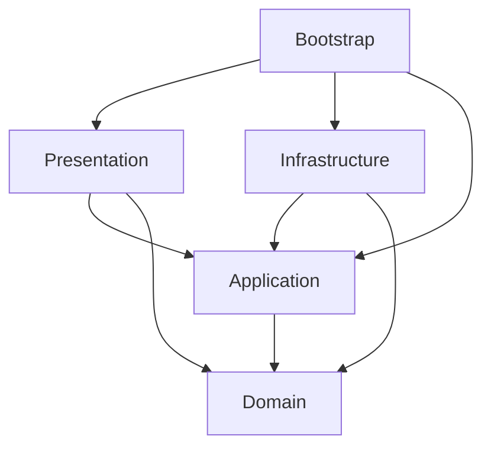
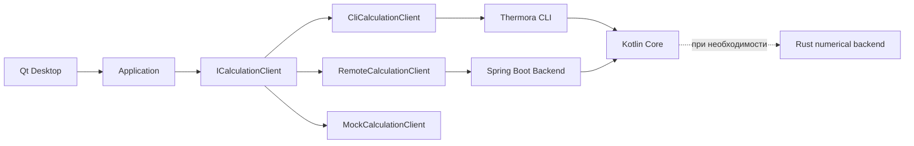

# Thermora Desktop — Architecture

**Версия документа:** 1.0  
**Статус:** Draft — целевая архитектура  
**Платформа:** Qt 6 Widgets / C++20  
**Система сборки:** CMake 3.21+  
**Расположение:** `desktop/qt-app/`

## 1. Назначение

Thermora Desktop — инженерный графический клиент для проектирования компоновки радиоэлектронной аппаратуры, настройки тепловых моделей, запуска расчётов и анализа результатов. Desktop не является самостоятельным физическим решателем: источником расчётных результатов служит Thermora Core.

Целевые возможности:

- создание, открытие, сохранение и редактирование проектов;
- выбор расчётной модели и настройка её параметров;
- библиотека компонентов, материалов и корпусов;
- интерактивная компоновка в 2D, позднее — 3D;
- редактирование геометрии, координат, мощности и граничных условий;
- локальные и удалённые расчёты;
- отображение температур, диагностик, графиков и пространственных полей при наличии соответствующих результатов;
- сравнение расчётов и экспорт результатов.

## 2. Технологические решения

| Компонент | Технология |
|---|---|
| Интерфейс | Qt 6 Widgets, программное построение форм |
| Главное окно | QMainWindow, QDockWidget |
| Деревья и таблицы | Qt Model/View, QAbstractItemModel |
| 2D-редактор | QGraphicsScene, QGraphicsView |
| Темизация | QPalette, QSS, SVG-ресурсы |
| Локальная интеграция | QProcess, JSON, Thermora CLI |
| Удалённая интеграция | Qt Network, HTTP/JSON, Spring Boot |
| Тестирование | Qt Test, CTest |
| Сборка | CMake, Ninja или другой генератор |

Qt Designer допустим для отдельных форм, но не обязателен. QML и технология 3D-визуализации пока не выбраны. Они могут быть добавлены без замены основной архитектуры.

## 3. Целевая структура репозитория

```text
Thermora/
├── docs/
│   └── QT_DESKTOP_ARCHITECTURE.md
├── foundation/
├── calculation/
├── numerical/
├── models/
├── application/
├── infrastructure/
├── interfaces/
│   └── cli/
├── desktop/
│   └── qt-app/
│       ├── CMakeLists.txt
│       ├── CMakePresets.json
│       ├── README.md
│       ├── cmake/
│       ├── src/
│       │   ├── main.cpp
│       │   ├── bootstrap/
│       │   │   ├── ApplicationBootstrap.hpp
│       │   │   └── ApplicationBootstrap.cpp
│       │   ├── domain/
│       │   │   ├── project/
│       │   │   ├── assembly/
│       │   │   ├── component/
│       │   │   ├── geometry/
│       │   │   └── calculation/
│       │   ├── application/
│       │   │   ├── ports/
│       │   │   ├── usecases/
│       │   │   ├── session/
│       │   │   └── commands/
│       │   ├── infrastructure/
│       │   │   ├── calculation/
│       │   │   │   ├── cli/
│       │   │   │   ├── remote/
│       │   │   │   └── mock/
│       │   │   ├── serialization/
│       │   │   ├── persistence/
│       │   │   ├── settings/
│       │   │   └── export/
│       │   └── presentation/
│       │       ├── shell/
│       │       ├── screens/
│       │       │   ├── welcome/
│       │       │   ├── projects/
│       │       │   ├── model-selection/
│       │       │   ├── workspace/
│       │       │   ├── results/
│       │       │   └── settings/
│       │       ├── editor/
│       │       │   ├── scene/
│       │       │   ├── items/
│       │       │   ├── tools/
│       │       │   └── interaction/
│       │       ├── panels/
│       │       ├── viewmodels/
│       │       ├── models/
│       │       ├── visualization/
│       │       ├── widgets/
│       │       └── theme/
│       ├── resources/
│       │   ├── thermora.qrc
│       │   ├── icons/
│       │   ├── styles/
│       │   │   ├── dark.qss
│       │   │   └── light.qss
│       │   └── translations/
│       └── tests/
│           ├── unit/
│           ├── integration/
│           ├── contract/
│           ├── gui/
│           └── fixtures/
└── backend/                       # планируется
```

Это целевая структура, а не требование создать все каталоги немедленно. Имена классов и размещение файлов уточняются по мере реализации. Допустимо сохранить существующий `main.cpp` в корне Qt-проекта до согласованного рефакторинга.

## 4. Слои и зависимости



| Слой | Ответственность |
|---|---|
| Domain | Редактируемые данные проекта, геометрия и инварианты компоновки. По возможности стандартный C++ без Qt. |
| Application | Сценарии использования, состояние сессии, команды, порты внешних сервисов. |
| Infrastructure | Реализация портов: CLI, HTTP, JSON, файлы и настройки. |
| Presentation | Окна, виджеты, сцена, ViewModel, адаптеры Qt Model/View. |
| Bootstrap | Создание объектов и внедрение зависимостей. |

Запрещены зависимости Domain от UI, прямые вызовы QProcess из виджетов, хранение единственного экземпляра проекта в графической сцене и дублирование физических формул Kotlin Core в C++.

## 5. Предметная модель Desktop

| Тип | Назначение |
|---|---|
| Project | Идентификатор, название, метаданные, компоновка и настройки расчёта |
| Assembly | Корпус и экземпляры компонентов |
| ComponentDefinition | Тип компонента и его исходные характеристики |
| ComponentInstance | Ссылка на определение, уникальный ID, положение, ориентация, параметры экземпляра |
| Enclosure | Геометрия корпуса и его свойства |
| CalculationConfiguration | Выбранная модель и её параметры |
| CalculationSnapshot | Неизменяемый снимок входных данных для запуска расчёта |
| CalculationResult | Результат Core, диагностика и метаданные модели |

Предметная модель Desktop обслуживает редактирование проекта и не заменяет физическую доменную модель Kotlin. Графические элементы ссылаются на стабильные ID компонентов. Пиксели не используются как физические единицы. Рекомендуется хранить геометрию в SI и показывать пользователю удобные единицы; точный формат координат, ориентации и единиц согласуется в контракте до интеграции.

## 6. Application и управление состоянием

Предлагаемые порты: `ICalculationClient`, `IProjectRepository`, `IComponentCatalog`, `ISettingsStore`, `IResultExporter`.

Сценарии: `CreateProject`, `OpenProject`, `SaveProject`, `AddComponent`, `MoveComponent`, `UpdateComponent`, `RemoveComponent`, `RunCalculation`, `CancelCalculation`, `ExportResult`.

`ProjectSession` хранит текущий проект, выделение, признак несохранённых изменений и ревизию. Команды редактирования должны поддерживать undo/redo; Qt-адаптер может использовать QUndoStack. ViewModel преобразует состояние приложения в данные для виджетов, а не становится вторым источником истины.

## 7. Presentation

### 7.1 Экраны

| Экран | Назначение |
|---|---|
| Welcome | Быстрый вход в приложение |
| Projects | Список, создание и открытие проектов |
| Model selection | Выбор доступной модели, описание ограничений |
| Workspace | Компоновка и настройка расчёта |
| Results | Результаты, диагностика, сравнение и экспорт |
| Settings | Тема, язык, единицы, режим подключения к Core |

### 7.2 Рабочая область

```text
┌─────────────────────────────────────────────────────────────┐
│ Thermora · Меню · Инструменты · Расчёт                      │
├──────────────┬───────────────────────────┬──────────────────┤
│ Дерево       │ Вкладки проекта           │ Инспектор        │
│ компонентов  │                           │ свойств          │
│              │     2D / будущий 3D       │ Геометрия        │
│ Библиотека   │     редактор              │ Мощность         │
│ компонентов  │                           │ Материал         │
├──────────────┴───────────────────────────┴──────────────────┤
│ Диагностика / результаты / журнал                          │
├─────────────────────────────────────────────────────────────┤
│ Статус · Масштаб · Координаты · Единицы · Режим расчёта      │
└─────────────────────────────────────────────────────────────┘
```

Основные классы: `MainWindow`, `WorkspaceScreen`, `ComponentTreePanel`, `ComponentLibraryPanel`, `PropertiesPanel`, `CalculationPanel`, `DiagnosticsPanel`, `ResultsPanel`. Панели могут быть докируемыми. Дерево и инспектор синхронизируются через состояние выделения.

### 7.3 Редактор

`AssemblyScene` отображает компоновку; `AssemblyView` отвечает за масштабирование и навигацию; `ComponentItem` и `EnclosureItem` визуализируют объекты; инструменты выделения, перемещения и размещения переводят действия пользователя в команды Application.

Поддерживаются сетка, привязка, выделение, масштабирование, панорамирование, перемещение и редактирование размеров. Перемещение обновляет предпросмотр, а завершение жеста фиксирует команду. Проверки пересечений и границ являются геометрическими проверками, а не тепловым расчётом.

### 7.4 Дизайн-система

Современный инженерный интерфейс с компактными панелями, согласованной типографикой, SVG-иконками, светлой и тёмной темами. `ThemeManager` управляет палитрой и QSS; стили не дублируются по экранам. Предусмотреть HiDPI, клавиатурную навигацию, контраст и локализацию через Qt Linguist. Нативные системные диалоги допустимы.

## 8. Интеграция с вычислительным ядром



### 8.1 Локальный режим

`CliCalculationClient` запускает установленный CLI через QProcess без shell-интерпретации аргументов. Путь к исполняемому файлу настраивается локально. Планируемые команды: `list-models`, `describe-model`, `calculate`. JSON передаётся через stdin/stdout; технические логи направляются в stderr. Desktop не должен запускать Gradle для каждого расчёта.

### 8.2 Удалённый режим

`RemoteCalculationClient` реализует тот же порт через HTTP/JSON. Spring Boot вызывает Kotlin Core. Адрес сервера, аутентификация, TLS и таймауты определяются отдельно. Переключение режима не требует изменения экранов. Автоматическое переключение на сервер без согласия пользователя не допускается.

### 8.3 Контракт

До реальной интеграции согласовать версию протокола, идентификаторы и версии моделей, единицы, координаты, структуру запросов и результатов, диагностику, коды ошибок и ограничения размеров сообщений. Для неизвестной версии возвращать явную ошибку. JSON-мапперы изолируются в Infrastructure. Не привязывать UI к внутренним классам Kotlin.

### 8.4 Асинхронность

Расчёты не блокируют GUI. QProcess и QNetworkAccessManager используются асинхронно. Каждый запуск связан с ID запроса и ревизией проекта; устаревший результат не заменяет актуальный. Предусмотреть отмену, таймауты и обработку падения процесса. Отмена удалённой задачи требует поддержки сервера. Для частых расчётов позднее можно добавить долгоживущий CLI-процесс с отдельным протоколом фрейминга.

### 8.5 Mock и Rust

Mock используется только для разработки UI и тестов; демонстрационные результаты явно маркируются. Rust — возможный вычислительный backend Core, а не обязательная зависимость Qt. Его API и способ интеграции определяются после профилирования.

## 9. Визуализация и физическая достоверность

Legacy-модели сохраняют исходные методики Excel. Если модель возвращает только усреднённые температуры, Desktop показывает именно эти величины, а не выдуманное пространственное поле. Перемещение компонента не гарантирует изменения результата legacy-модели.

Тепловые карты, изотермы и 3D-поля отображаются только при наличии соответствующих данных от improved-моделей. Визуальная интерполяция допустима как явно обозначенный способ отображения, а не как самостоятельный физический расчёт. Результаты должны содержать единицы, легенду, модель и ревизию входных данных.

## 10. Хранение и экспорт

Предлагается версионированный JSON-формат проекта, отдельный от транспортного формата расчёта. Сохранение выполняется атомарно, например через QSaveFile. При открытии проверяется версия и корректность данных. Локальные настройки приложения хранятся через QSettings. Секреты не записываются в проект. Форматы экспорта CSV, JSON, изображений и отчётов реализуются по необходимости. Расширение файла проекта и схема миграций пока не утверждены.

## 11. CMake и тестирование

Qt-проект является самостоятельным CMake-проектом и не включается в Gradle settings. Рекомендуемые цели по мере роста: `thermora_desktop_domain`, `thermora_desktop_application`, `thermora_desktop_infrastructure`, `thermora_desktop_presentation`, `thermora-desktop`. Начать можно с одного executable и выделять библиотеки по мере появления кода.

Пути Qt не хардкодятся: использовать CMAKE_PREFIX_PATH, локальные настройки IDE или CMakeUserPresets.json (не коммитить). Общие CMakePresets.json не должны содержать персональных путей. Для Network и Test добавить соответствующие Qt-компоненты при реализации.

```bash
cmake -S desktop/qt-app -B desktop/qt-app/build -DCMAKE_PREFIX_PATH=/opt/homebrew/opt/qt
cmake --build desktop/qt-app/build
ctest --test-dir desktop/qt-app/build --output-on-failure
```

Путь выше — пример для Homebrew на Apple Silicon, не универсальное требование.

| Тесты | Проверки |
|---|---|
| Unit | Геометрия, команды, состояние, undo/redo, преобразования |
| Integration | Сохранение, загрузка, QProcess, ошибки HTTP |
| Contract | Совместимость JSON с CLI, эталонные fixtures, версии |
| GUI | Выделение, редактирование, навигация, состояния ошибок |

Тесты физической корректности остаются в Kotlin Core. CI Desktop должен собирать CMake и запускать CTest независимо от Gradle; целевые ОС и порог покрытия согласуются отдельно.

## 12. Правила командной разработки

Один монорепозиторий, независимые сборки. Разработчик Desktop работает в своём Fork, создаёт короткие feature-ветки и отправляет PR в main основного репозитория. Изменения Core и общего протокола согласуются с владельцем проекта. Не коммитить IDE-настройки, build-каталоги, локальные Qt-пути и секреты. Каждый PR должен содержать ограниченный объём изменений и проверяемые критерии готовности.

## 13. Этапы реализации

| Этап | Результат и критерий готовности |
|---|---|
| 0. Bootstrap | Qt-окно собирается и запускается; переносимый CMake |
| 1. Shell | Навигация, проекты, выбор модели, базовая тема |
| 2. Editor | Компоненты, сцена, инспектор, undo/redo, сохранение |
| 3. Mock integration | Асинхронный сценарий расчёта с маркированными fixtures |
| 4. Local integration | Реальный CLI, контрактные тесты, ошибки и диагностика |
| 5. Results | Отображение фактических результатов и сравнение |
| 6. Remote integration | Spring Boot, переключение режима, сетевые ошибки |
| 7. Advanced visualization | Пространственные модели, поля и при необходимости 3D |

## 14. Текущий статус и открытые решения

По предыдущим проверкам минимальные Qt Widgets и CLI запускались. Актуальное состояние репозитория, существующие экраны и CMake-цели в рамках подготовки документа не проверялись. Данный документ описывает целевое устройство, а не перечень реализованных возможностей.

Предлагаемые, но ещё не утверждённые решения: границы CMake-библиотек, конкретные классы и порты, формат проекта, C++-представление единиц, координатный контракт, HTTP API, технология 3D, способ подключения Rust и упаковка приложения. Перед реализацией интеграции их необходимо согласовать с архитектурой Core и фактическим JSON API.
